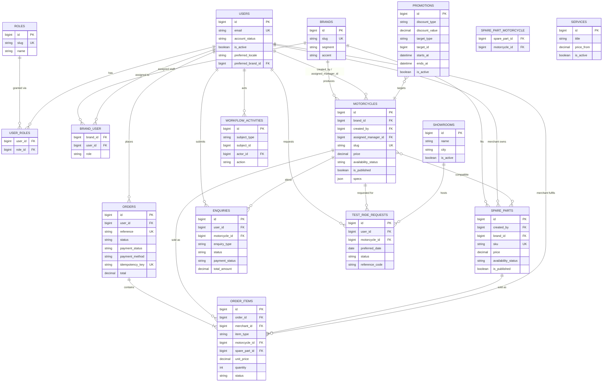
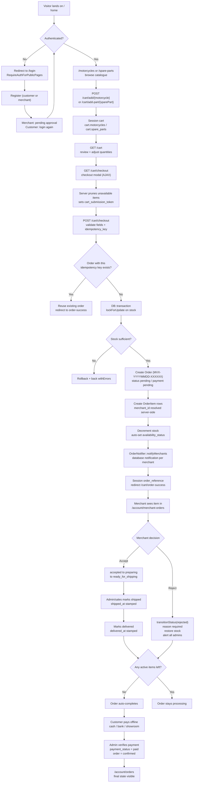
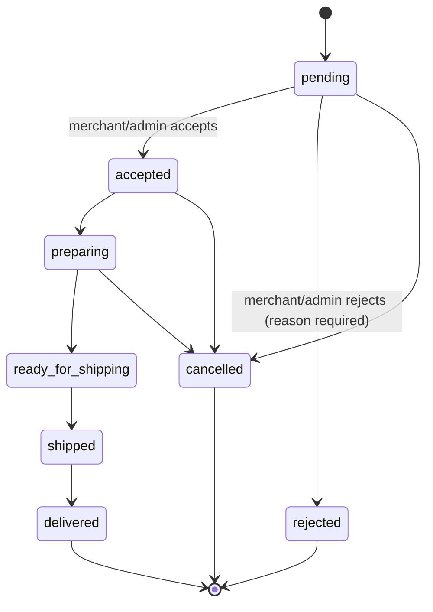
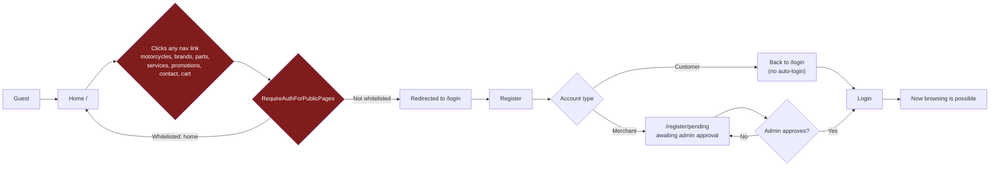
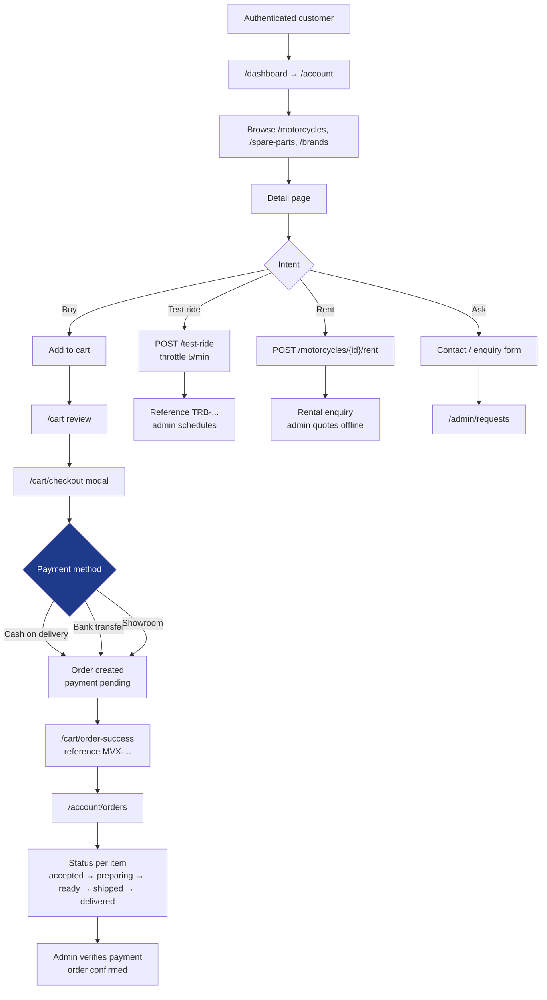
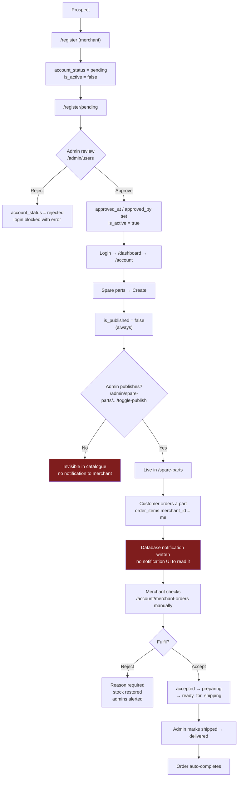
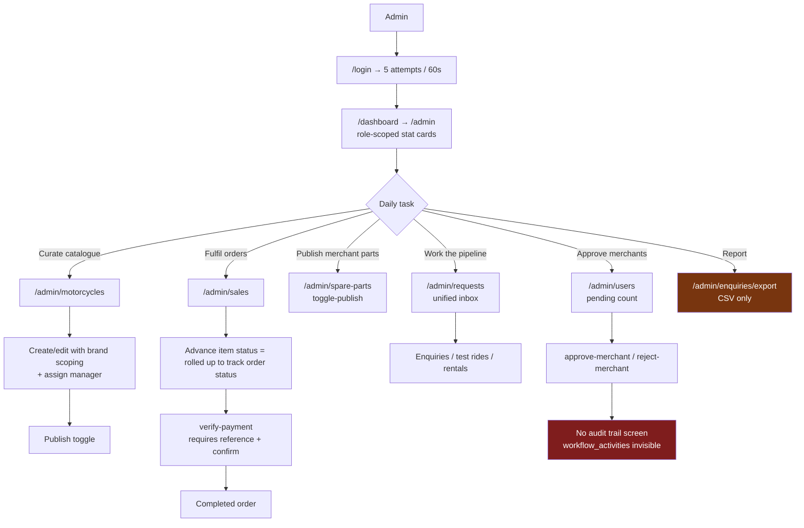

# MOTOVEX — Complete Website & System Analysis

| Field | Value |
|---|---|
| Project | MOTOVEX (`d:\MOTOVEX\motovex`) |
| Document type | Full-stack analysis & audit report (read-only) |
| Analysis date | October 31, 2026 |
| Framework version (verified at runtime) | Laravel Framework **12.70.1** |
| PHP requirement (from `composer.json`) | `^8.2` |
| Routes registered (from `php artisan route:list`) | **137** |
| Blade views | **115** |
| Controllers | **30** |
| Eloquent models | **13** |
| Migrations | **35** |
| Language files | **16 EN + 16 AR** |
| Test files | **10** (`tests/Feature` + `tests/Unit`) |
| Automated test run (verified) | **24 failed, 90 passed (348 assertions), 62.88 s** |
| Method | Static inspection of every route, controller, request, middleware, policy, model, migration, view, language file, config file + `php artisan` runtime checks |

> **Scope discipline:** this report was produced by inspection only. No application code, migration, route, configuration, view, or database record was modified, deleted, renamed, or generated. No credentials, tokens, or environment secrets are reproduced here. Where a conclusion could not be proven from code, it is explicitly marked **Requires Verification**.

---

## Executive Summary

MOTOVEX is a Laravel 12 motorcycle retail platform covering four commercial flows — motorcycle sales, a merchant-supplied spare-parts marketplace, service enquiries, and test-ride/rental requests — with five roles, English/Arabic localization, and a per-line-item fulfilment state machine. The backend is substantially complete and in places genuinely well engineered. The product is nonetheless **not shippable today**, for five concentrated reasons.

| # | Blocking issue | Severity | One-line effect |
|---|---|---|---|
| 1 | A global middleware forces login on every public page except the home page | **Critical** | Guests cannot browse motorcycles, parts, brands, services, promotions, or even the contact page |
| 2 | Promotions are displayed but never applied at checkout | **High** | The advertised price is not the charged price |
| 3 | No payment gateway exists anywhere; payment is offline with manual admin verification | **Critical** | The "e-commerce" system tracks orders but collects no money |
| 4 | The frontend is six unreconciled design systems across three frameworks, with the compiled design system used by only 3 of 115 views | **High** | The site looks like several different products; RTL fixes apply to the pages that need them least |
| 5 | 24 of 114 tests fail and three registered middleware aliases are dead | **High** | The regression gate is red and the security layer is partly decorative |

**What is strong:** the `OrderItem` state machine with enumerated transitions and mandatory rejection reasons; `lockForUpdate` stock handling inside transactions; server-side merchant attribution at checkout; brand-scoped authorization that blocks data-entry staff from other brands; admin-only publication of merchant inventory; and a complete, parallel Arabic translation set.

**Recommended order of work:** open the doors (remove the global auth gate, restore guest browsing) → make the price honest (apply promotions, wire a payment provider) → make failures graceful (catch domain exceptions, unify the account-status signal, green the tests) → unify the surface (one design system, one asset pipeline, one order pipeline). Phases 1–2 change the product's posture; Phases 3–5 make it maintainable and competitive.

**Measured facts behind these conclusions:** Laravel 12.70.1 · 137 routes · 115 Blade views · 30 controllers · 13 models · 35 migrations · 21 tables · 16+16 language files · `php artisan test` → 24 failed, 90 passed, 348 assertions, 62.88 s · zero payment-gateway integrations found.

---

## Table of Contents

- [Executive Summary](#executive-summary)
- [1. Project Overview & Business Concept](#1-project-overview--business-concept)
- [2. Complete Technology Stack](#2-complete-technology-stack)
- [3. Complete Website Pages Analysis](#3-complete-website-pages-analysis)
- [4. Complete Dashboard Analysis](#4-complete-dashboard-analysis)
- [5. Authentication & Authorization](#5-authentication--authorization)
- [6. Database Architecture & Relationships](#6-database-architecture--relationships)
- [7. Complete E-commerce Workflow](#7-complete-e-commerce-workflow)
- [8. Backend Architecture](#8-backend-architecture)
- [9. Frontend Architecture & UI/UX](#9-frontend-architecture--uiux)
- [10. Localization (AR / EN)](#10-localization-ar--en)
- [11. Security Audit](#11-security-audit)
- [12. Performance & Code Quality](#12-performance--code-quality)
- [13. Integrations & External Dependencies](#13-integrations--external-dependencies)
- [14. System Status & Feature Completeness](#14-system-status--feature-completeness)
- [15. Navigation & User Journey Mapping](#15-navigation--user-journey-mapping)
- [16. Project File Structure](#16-project-file-structure)
- [17. Bugs, Technical Debt & Improvement Opportunities](#17-bugs-technical-debt--improvement-opportunities)
- [18. Recommended Development Roadmap](#18-recommended-development-roadmap)
- [19. Analysis Methodology & Rules Applied](#19-analysis-methodology--rules-applied)
- [20. Document Structure, Verification & Coverage](#20-document-structure-verification--coverage)

---

## 1. Project Overview & Business Concept

### 1.1 What MOTOVEX is

MOTOVEX is a **Laravel 12 monolith** implementing a motorcycle retail and services platform. It is not a single-purpose storefront: the same codebase carries four distinct commercial flows behind one catalogue:

1. **Motorcycle retail** — brand → model catalogue with per-unit stock, condition (new/used), availability (available/reserved/sold) and rental pricing.
2. **Spare-parts marketplace** — spare parts supplied by self-registered *merchants*, each part bound to the merchant who created it, published only after administrator approval.
3. **Service booking enquiry** — service centre catalogue (maintenance, diagnostics, customisation, etc.) captured as enquiries rather than booked time slots.
4. **Test-ride and rental requests** — a dedicated `test_ride_requests` table with booking date/time/venue fields, plus a rental enquiry type carrying start/end dates and days count.

### 1.2 Business model as actually implemented

| Dimension | Implementation | Evidence |
|---|---|---|
| Revenue model | **Lead / order-request generation with manual payment verification** | `Enquiry::PAYMENT_*` constants, `admin.orders.verify-payment`, `admin.sales.verify-payment`, `Order::PAYMENT_*`, `payment_verified_at` / `payment_verified_by` |
| Payment | **Offline only.** Three customer-facing choices: `cash_on_delivery`, `bank_transfer`, `showroom`. No gateway integration exists anywhere in the codebase (grep for Stripe/Paymob/PayPal/Fawry/HyperPay/Braintree/Iyzico/Checkout.com returned zero matches) | `CartController::placeOrder` validation, `orders.payment_method` |
| Fulfilment | Per-line-item state machine handled by the owning merchant, with admin oversight | `OrderItem::$transitions`, `account.merchant-orders.update-status`, `admin.sales.items.update-status` |
| Inventory | Decremented on order placement, restored on rejection with `lockForUpdate` inside `DB::transaction` | `CartController::placeOrder`, `OrderController::restoreStock` |
| Multi-vendor | Yes — spare parts are attributed to `merchant_id`; orders are canonical and split logically per merchant | `order_items.merchant_id`, `OrderItem::scopeForMerchant` |
| Geography | Egypt-oriented (governorate field, Cairo / Noto Kufi Arabic fonts, EGP pricing context) | `CartController::placeOrder` `city` + `governorate`, `lang/ar` |
| Language | Bilingual English / Arabic with RTL | `lang/en`, `lang/ar`, `SetLocale`, `partials/rtl-styles` |

### 1.3 Organisational structure encoded in the system

The project carries the imprint of a **multi-brand dealership group**. The leftover `config/group.php` still ships the parent-brand strings **"APEX MOTO GROUP"** and **"FUELLED BY YOUR CONVICTION"**, while the admin shell labels itself **"MotoTrade / Ride Your Business"** and the public layout is branded MOTOVEX. This is a real, visible inconsistency (see [§17](#17-bugs-technical-debt--improvement-opportunities)).

Staff are further partitioned **per brand**: `brand_user` is a many-to-many pivot with a `role` column, and `User::canManageBrand()` / `Motorcycle::scopeResponsibleFor()` restrict data-entry staff to the brands they were assigned. This is a genuine multi-tenant-lite design, not a flat admin panel.

### 1.4 Roles

| Role slug | Label | Purpose | Seeded by |
|---|---|---|---|
| `admin` | Administrator | Full control, including payment verification, publishing, user management | `RoleSeeder` |
| `data_entry` | Data entry | Catalogue work scoped to assigned brands | `RoleSeeder` |
| `sales_agent` | Sales agent | Sales pipeline across all brands, no catalogue write on brands | `RoleSeeder` |
| `merchant` | Merchant | Self-registers, gated by admin approval, manages own spare parts | `RoleSeeder` / `RegisterController` |
| `customer` | Customer | Public buyer/renter account | `RegisterController` |

Account lifecycle is tracked by `users.account_status` ∈ `{active, pending, rejected}` in addition to a legacy boolean `users.is_active`. Both are checked in different places, which produces the most user-visible defect in the system (see [§11](#11-security-audit) and [§17](#17-bugs-technical-debt--improvement-opportunities)).

### 1.5 Project maturity — one-paragraph verdict

The **data layer, authorization model, and order state machine are the strongest parts** of this codebase: transitions are enumerated in code, invalid transitions throw, stock is locked, merchants are resolved server-side rather than trusted from the client, and audit rows are written automatically by model events. The **delivery layer is not production-ready**: a global middleware blocks guests from every public catalogue page, the visual system is fragmented across six unreconciled palettes, the admin shell is labelled with a competitor-style brand name, there is no payment provider, no notification inbox despite notifications being written to the database, and 21% of the test suite fails. The gap between "backend domain design" and "shippable product" is the single most important finding in this report.

---

## 2. Complete Technology Stack

### 2.1 Backend

| Component | Version / Setting | Source |
|---|---|---|
| Framework | Laravel **12.70.1** (runtime verified) | `php artisan --version` |
| PHP | `^8.2` | `composer.json` |
| Application bootstrap | `bootstrap/app.php` with `Application::configure()` fluent API, `withMiddleware`, `withExceptions` | `bootstrap/app.php` |
| Providers | `app/Providers/AppServiceProvider.php`, `app/Providers/AuthServiceProvider.php` (registered via `bootstrap/providers.php`) | `bootstrap/providers.php` |
| Routing | Two files only: `routes/web.php`, `routes/console.php`. **No `routes/api.php`** — there is no API surface | `routes/` |
| View layer | Blade with `layouts.app` (3 pages), `layouts.account` (11 views), `layouts.admin` (admin views), plus 10 standalone full-HTML Blade pages | `resources/views/**` |
| Session | `database` driver, `SESSION_DRIVER=database` | `.env.example`, `config/session.php` |
| Queue | `database` driver, `QUEUE_CONNECTION=database` | `.env.example` |
| Cache | `database` store | `.env.example` |
| Mail | `log` driver — **no real mail transport configured** | `.env.example`, `config/mail.php` |
| DB (dev default) | SQLite (`DB_CONNECTION=sqlite`), file `database/database.sqlite` | `.env`, `.env.example`, `config/database.php` |
| Notifications | Database channel only | `app/Notifications/NewOrderReceived.php` |
| Auth | Session guard, custom `LoginController` / `RegisterController` / password reset; `AuthServiceProvider` registers 6 policies | `config/auth.php`, `app/Providers/AuthServiceProvider.php` |
| Authorization | Policies + Gates + `role` middleware + `authorizeResource` | `app/Policies/*`, `app/Http/Middleware/CheckRole.php` |
| Rate limiting | Named limiter `register` (in `AppServiceProvider`) + `throttle:5,1` on public lead forms + in-controller `RateLimiter` for login | `AppServiceProvider`, `routes/web.php`, `LoginController` |
| Testing | PHPUnit via `php artisan test`; `phpunit.xml` forces `sqlite :memory:`, `array` cache/session, `sync` queue | `phpunit.xml` |

### 2.2 Frontend build

| Component | Version | Notes |
|---|---|---|
| Vite | `^6` | `vite.config.js`, `laravel-vite-plugin` + `@vitejs/plugin` |
| Tailwind CSS | `^4` via `@tailwindcss/vite` | Configured **in CSS** using `@theme`, not a `tailwind.config.js` |
| Alpine.js | `^3` + `@alpinejs/focus` | Booted in `resources/js/app.js` |
| GSAP | `^3` | Imported in `resources/js/app.js` |
| Lenis | `^1` | Smooth-scroll library, imported in `app.js` |
| lucide | `^0.x` | Icon library, imported in `app.js` |
| Fonts (bundled) | `@fontsource/inter`, `@fontsource/orbitron` | Declared in `package.json` |
| npm scripts | `dev`, `build`, `watch` | `package.json` |

### 2.3 CDN dependencies loaded at runtime

This is the most significant stack finding: the project mixes a compiled Tailwind 4 pipeline with **six independent CDN loading strategies**, so the same page can load two icon sets and two font stacks.

| Asset | Version | Used by |
|---|---|---|
| Bootstrap CSS | 5.3.3 (jsDelivr) | `layouts/admin` |
| Bootstrap Icons | latest (jsDelivr) | `layouts/admin` |
| Bootstrap JS bundle | 5.3.3 (jsDelivr) | `layouts/admin` |
| Tailwind Play CDN | `https://cdn.tailwindcss.com` | 12+ standalone public pages **and** `layouts/account` |
| Font Awesome | 6.0.0 (some views), 6.5.2 (others) — **two different versions** | `layouts/app`, standalone pages |
| Google Fonts | Cairo, Inter, Plus Jakarta Sans, Noto Kufi Arabic | multiple |
| GSAP CDN | referenced in standalone pages | some public pages |
| AOS / Swiper / Slick | referenced in standalone page markup | some public pages |

### 2.4 Toolchain & config files

`.editorconfig`, `.gitattributes`, `.gitignore`, `.vscode/settings.json`, `composer.json`/`composer.lock`, `package.json`/`package-lock.json`, `phpunit.xml`, `vite.config.js`, `artisan`.
Config directory: `app`, `auth`, `cache`, `database`, `filesystems`, `group` (**non-standard, project-specific**), `logging`, `mail`, `queue`, `services`, `session`.

### 2.5 What the stack does *not* include

Verified absent (not "unknown" — searched and found zero occurrences):

- No payment SDK (Stripe, Paymob, Fawry, HyperPay, PayPal, Braintree, Iyzico, Checkout.com).
- No SMS/WhatsApp provider (Twilio, Vonage, Unifonic, Infobip).
- No push provider (FCM, OneSignal).
- No search engine (Algolia, Meilisearch, Scout, Typesense).
- No image transformation service (Cloudinary, imgix).
- No analytics (GA, GTM, Plausible, Matomo).
- No social login (Laravel Socialite absent from `composer.json`).
- No API layer, no Sanctum/Passport (absent from `composer.json`), no queue worker consumers beyond default.
- No CI configuration (`.github/workflows` absent).

### 2.6 Stack verdict

**Coherent backend, incoherent frontend.** The PHP side uses one idiom consistently (Form Requests, policies, scopes, transactions). The presentation side is six parallel design languages built at different times with different tools. Any serious UI work should first collapse the frontend stack to a single pipeline (compiled Tailwind 4 + one icon set + one font set) before touching visual design — otherwise every new page adds a seventh palette.

---

## 3. Complete Website Pages Analysis

### 3.1 Page inventory (public-facing)

137 routes are registered; **28 are customer-facing pages**. The table below is the authoritative public map, taken from `php artisan route:list`.

| # | Route name | URI | Methods | Layout / shell | Guest access |
|---|---|---|---|---|---|
| 1 | `home` | `/` | GET | `layouts.app` | **Allowed** (explicitly whitelisted) |
| 2 | `brands.index` | `/brands` | GET | Standalone HTML | **Blocked → redirect to `/login`** |
| 3 | `brands.show` | `/brands/{brand}` | GET (slug binding) | Standalone HTML | Blocked |
| 4 | `motorcycles.index` | `/motorcycles` | GET | Standalone HTML | Blocked |
| 5 | `motorcycles.show` | `/motorcycles/{motorcycle}` | GET (slug binding) | Standalone HTML | Blocked |
| 6 | `spare-parts.index` | `/spare-parts` | GET | Standalone HTML | Blocked |
| 7 | `spare-parts.show` | `/spare-parts/{sparePart}` | GET (id binding) | Standalone HTML | Blocked |
| 8 | `services` | `/services` | GET | Standalone HTML | Blocked |
| 9 | `promotions` | `/promotions` | GET | Standalone HTML | Blocked |
| 10 | `contact` | `/contact` | GET, POST | Standalone HTML | Blocked |
| 11 | `cart.index` | `/cart` | GET | `layouts.app` | Blocked |
| 12 | `cart.add` | `/cart/add/{motorcycle}` | POST | — (redirect) | Blocked |
| 13 | `cart.remove` | `/cart/remove/{motorcycle}` | DELETE | — (redirect) | Blocked |
| 14 | `cart.clear` | `/cart/clear` | DELETE | — (redirect) | Blocked |
| 15 | `cart.add-part` | `/cart/add-part/{sparePart}` | POST | — (redirect/JSON) | Blocked |
| 16 | `cart.update-part` | `/cart/update-part/{sparePart}` | PATCH | — (JSON) | Blocked |
| 17 | `cart.remove-part` | `/cart/remove-part/{sparePart}` | DELETE | — (JSON) | Blocked |
| 18 | `cart.checkout` | `/cart/checkout` | GET | `layouts.app` + `cart.checkout-modal` partial | Blocked (needs `auth`,`active`) |
| 19 | `cart.place-order` | `/cart/checkout` | POST | — (redirect) | Blocked (needs `auth`,`active`) |
| 20 | `cart.order-success` | `/cart/order-success` | GET | Standalone HTML | Blocked (needs `auth`,`active`) |
| 21 | `test-ride.store` | `/test-ride` | POST (`throttle:5,1`) | — (redirect back) | Runtime-blocked by global middleware |
| 22 | `rentals.store` | `/motorcycles/{motorcycle}/rent` | POST (`throttle:5,1`) | — (redirect back) | Runtime-blocked by global middleware |
| 23 | `contact.store` | `/contact` | POST | — (redirect back) | Blocked |
| 24 | `login` | `/login` | GET, POST | Standalone HTML | Guest-only |
| 25 | `register` | `/register` | GET, POST (`throttle:register`) | Standalone HTML | Guest-only |
| 26 | `register.pending` | `/register/pending` | GET | Standalone HTML | Allowed |
| 27 | `merchant.pending` | `/merchant/pending` | GET | Standalone HTML | Needs `auth` |
| 28 | `password.request` / `password.reset` / `password.email` / `password.store` | `/forgot-password`, `/reset-password/{token}` | GET, POST | Standalone HTML | Guest-only |
| 29 | `lang.switch` | `/lang/{locale}` | GET | — (redirect back) | Allowed |
| 30 | `dashboard` | `/dashboard` | GET | — (role redirect) | Needs `auth`,`active` |
| 31 | `storage.local` | `/storage/{path}` | GET/PUT | — | Framework route |

### 3.2 The blocking defect, stated once

`app/Http/Middleware/RequireAuthForPublicPages.php` is registered as a **global `web` group middleware** in `bootstrap/app.php`:

```php
$middleware->web(append: [
    \App\Http\Middleware\SetLocale::class,
    \App\Http\Middleware\RequireAuthForPublicPages::class,
]);
```

Its whitelist is `OPEN_ROUTE_NAMES = home, login, register, register.pending, password.*, lang.switch, logout` and `OPEN_URI_PREFIXES = login, register, forgot-password, reset-password, lang`. **Everything else is redirected to `/login` for guests.** Consequence, verified by the failing test suite: an unauthenticated visitor cannot see motorcycles, brands, spare parts, services, promotions, cart, or the contact page. A shopping site where nothing is browsable without an account is not a "soft launch" configuration — it is a hard product blocker. Every page documented below is therefore described twice: *as built* (for authenticated users) and *guest reality* (redirect).

### 3.3 Page-by-page analysis

The specification's 16 attributes are covered for each page in the following order: **route/path · purpose · access · layout · sections · data shown · forms · actions · validation · error states · loading states · empty states · responsive · RTL · localization · navigation in/out**. Where an attribute is identical across pages it is stated once and referenced.

#### 3.3.1 Home — `GET /` (`home`)

| Attribute | Detail |
|---|---|
| **Purpose** | Brand landing page and primary funnel into catalogue, services, and contact. |
| **Access** | Public (the only genuinely public content page). |
| **Layout** | `layouts.app` (Font Awesome 6.0.0 CDN, `@vite` CSS/JS, `partials.rtl-styles`, navbar + footer partials). |
| **Sections** | 7 anchor sections: `#home` hero, `#categories`, `#motorcycles`, `#services`, `#about`, `#why-motovex`, `#contact`. 1,283 lines, monolithic — it does **not** include the `resources/views/home/*` partials that exist in the repo. |
| **Data shown** | Featured/highlight motorcycles, brand categories, service list, promotional copy, contact block. |
| **Forms** | Contact form anchored at `#contact` (component-level, posts to `contact.store` only if the visitor is authenticated — otherwise redirected at the global middleware before the controller). |
| **Actions** | Hero CTA into catalogue, category tiles, service cards, nav links, language switch. |
| **Validation** | Inherited from `StoreContactRequest` on POST. |
| **Error / loading / empty states** | No skeleton loaders; empty catalogue sections render headings with no cards. Flash `session('success')` banner at layout level; `error`/`info` handled inside the navbar partial. |
| **Responsive** | Grid-based; mobile hamburger drawer in `partials.navbar`. |
| **RTL** | `<html dir="{{ $dir }}">` from shared view data + `partials.rtl-styles`. |
| **Localization** | Partly `__()`; partly **hardcoded bilingual ternaries** in the navbar (`$isAr ? '...' : '...'`). |
| **Navigation out** | Navbar → motorcycles, brands, spare parts, services, promotions, contact; footer link groups; dashboard/account buttons. |
| **Defect notes** | Defines its own CSS variables (`--mx-bg:#060C1A`, `--mx-purple:#7C3AED`) that **override** the compiled `app.css` design tokens. Inline `<link>` for Cairo/Inter Google Fonts duplicates the bundled `@fontsource` imports. |

#### 3.3.2 Motorcycle listing — `GET /motorcycles` (`motorcycles.index`)

| Attribute | Detail |
|---|---|
| **Purpose** | Browse/search the motorcycle catalogue with filters. |
| **Access** | Auth required (global middleware). Guests are redirected to `/login`. |
| **Layout** | **None.** Full standalone HTML document (712 lines) with `@include('partials.navbar')` and footer; loads `https://cdn.tailwindcss.com` plus its **own** inline `tailwind.config` (palette `#050b18`, `brand-*` purple scale, Plus Jakarta Sans). |
| **Sections** | Page header / breadcrumb, filter sidebar or filter bar, sort control, grid of product cards, pagination. |
| **Data shown** | Published motorcycles (scope `published()` = `is_published` **and** published brand), brand name, price, condition, availability badge, primary image via `image_url` accessor. |
| **Forms** | Filter form (brand, category, condition, availability, price range, sort) submitted as GET query string; free-text search. |
| **Actions** | Card → `motorcycles.show`; add-to-cart from card/list; clear filters. |
| **Validation** | Filter parameters tolerated defensively via query scopes; no Form Request (read-only). |
| **Error states** | Unvalidated filter combinations simply return an empty grid. |
| **Loading states** | None (server-rendered). |
| **Empty states** | "No motorcycles found" block present. |
| **Responsive** | Card grid collapses 4→2→1; filter panel stacks. |
| **RTL** | Inherits `dir`; Tailwind logical utilities used inconsistently (some `ml-`/`mr-` remain). |
| **Localization** | Mixed: `__()` keys for headings + hardcoded English strings inside cards. |
| **Navigation in/out** | In from home categories/navbar; out to `motorcycles.show`, `brands.show`, cart. |
| **Defect notes** | Because it does not extend a layout, it **completely bypasses `partials.rtl-styles`** and the compiled Tailwind bundle; the same selector can therefore render differently from `/` and `/cart`. |

#### 3.3.3 Motorcycle detail — `GET /motorcycles/{motorcycle:slug}` (`motorcycles.show`)

| Attribute | Detail |
|---|---|
| **Purpose** | Convert interest into an enquiry, a cart addition, a rental request, or a test-ride booking. |
| **Access** | Auth required. |
| **Layout** | Standalone (845 lines), own Tailwind CDN config. |
| **Sections** | Gallery (primary + `additional_images` JSON array), spec table (engine capacity, year, category, condition, availability), price + rental price/day, promo-price block if a live promotion matches, enquire form, test-ride form, rental form, related motorcycles. |
| **Data shown** | Full `Motorcycle` model incl. `specs` JSON; live `Promotion` via `scopeLive()` with `discountedPrice()` / `savingsAmount()`; assigned manager contact where present. |
| **Forms** | 3 separate forms → `contact.store` (type `product`), `test-ride.store`, `rentals.store`. |
| **Actions** | Add to cart (`POST /cart/add/{motorcycle}`), request test ride, request rental, phone/WhatsApp reveal. |
| **Validation** | `StoreContactRequest`, `StoreTestRideRequest`; inline HTML5 `required` attributes too. |
| **Error states** | `$errors` bag rendered per field on the three forms (shared block pattern). |
| **Loading states** | None. |
| **Empty states** | Gallery falls back to a placeholder image; specs hide null rows. |
| **Responsive** | Two-column → stacked. |
| **RTL / Localization** | Same pattern as listing: `dir` inherited, strings partially translated. |
| **Navigation out** | Back to listing, brand page, cart, related items. |
| **Defect notes** | Route model binding is by **slug** here but admin routes bind by **id** — two identity conventions for the same entity. |

#### 3.3.4 Brand index / detail — `GET /brands`, `GET /brands/{brand:slug}`

| Attribute | Detail |
|---|---|
| **Purpose** | Present manufacturer brands as landing destinations ("segments") and route users into filtered catalogues. |
| **Access** | Auth required. |
| **Layout** | Standalone (891 / 622 lines), Tailwind CDN, `brand-*` purple palette. |
| **Sections (index)** | Hero, brand grid with logo, segment label, accent colour, model count, CTA. **`brands.segment` + `brands.accent` columns exist purely to drive this presentation.** |
| **Sections (detail)** | Brand hero with accent colour, description, model grid scoped to the brand, related spare parts ("compatible"), enquiry CTA. |
| **Data shown** | `Brand` with `logo_url` / `hero_image_url` accessors, `motorcycles` relation (published), `spareParts` via `spare_part_motorcycle` pivot. |
| **Forms** | Brand-level enquiry (post to `contact.store`). |
| **Actions** | Filter catalogue by brand, open model, enquiry. |
| **Validation** | N/A on read. |
| **Error states** | 404 on unknown slug (implicit binding). |
| **Empty states** | "No models yet" block. |
| **Responsive / RTL / Localization** | Same as catalogue pages. |
| **Defect notes** | Brand `accent` is a DB-stored colour that is **not** driven from the design system — it is a free-text hex value, so a typo produces an invisible accent (no validation beyond string length). |

#### 3.3.5 Spare parts listing / detail — `GET /spare-parts`, `GET /spare-parts/{sparePart}`

| Attribute | Detail |
|---|---|
| **Purpose** | Marketplace surface for merchant-supplied parts. |
| **Access** | Auth required. |
| **Layout** | Standalone (323 / 314 lines), Tailwind CDN — the two smallest public pages. |
| **Sections (index)** | Category chips (11 categories from `SparePart::$categories`), search, availability filter, part cards with price, stock badge, merchant attribution, compatibility count. |
| **Sections (detail)** | Image, price, availability, compatible motorcycle list (pivot), add-to-cart with quantity, merchant block. |
| **Data shown** | `SparePart` scope `published()` **and** `available()`, `image_url`, `compatibleMotorcycles`. |
| **Forms** | Search/filter (GET); quantity + add-to-cart. |
| **Actions** | `POST /cart/add-part/{sparePart}`, `PATCH /cart/update-part/{sparePart}`, `DELETE /cart/remove-part/{sparePart}` (JSON). |
| **Validation** | Quantity handled in `CartController` with clamping; no `min`/`max` guard visible on the input markup. |
| **Error states** | Out-of-stock parts are filtered out of the listing but remain reachable by direct URL → cart silently rejects. |
| **Loading / empty states** | Empty category → empty grid; no skeletons. |
| **Responsive / RTL / Localization** | Same standalone pattern. |
| **Defect notes** | Identification uses `{sparePart}` **id**, exposing sequential primary keys in public URLs. Low severity, but inconsistent with slug-bound motorcycles and brands. |

#### 3.3.6 Services — `GET /services` (`services`)

| Attribute | Detail |
|---|---|
| **Purpose** | Present the workshop/service offering and capture service enquiries. |
| **Access** | Auth required. |
| **Layout** | Standalone (333 lines), Tailwind CDN. |
| **Data shown** | `Service` records (`title`, `description`, `icon`, `price_from`, `duration`, `is_active`, order/`details`). |
| **Forms** | Service enquiry form → `contact.store` with `enquiry_type = service`. |
| **Actions** | "Request this service", phone link. |
| **Validation / error / empty** | Form validation from `StoreContactRequest`; inactive services hidden by the controller query; empty state block present. |
| **Defect notes** | Services have **no booking mechanism** — no slot, no date, no capacity, no confirmation. It is a lead form with a service dropdown. |

#### 3.3.7 Promotions — `GET /promotions` (`promotions`)

| Attribute | Detail |
|---|---|
| **Purpose** | Marketing surface for active discount campaigns. |
| **Access** | Auth required. |
| **Layout** | Standalone (250 lines), Tailwind CDN. |
| **Data shown** | `Promotion` filtered by `scopeLive()` = `is_active` **and** `starts_at <= now <= ends_at`; discount type/value, target scope, hero image. |
| **Forms** | None (pure display). |
| **Actions** | Click-through to the targeted motorcycle or brand. |
| **Defect notes** | Discount display is **not applied at checkout**. `Promotion::discountedPrice()` exists and is used for presentation, but `CartController::placeOrder()` totals line items from `Motorcycle::price` / `SparePart::price` — the customer sees a discounted price on the promo page and a full price in the order. This is a **High**-severity commercial inconsistency (see §17). |

#### 3.3.8 Contact — `GET|POST /contact` (`contact`, `contact.store`)

| Attribute | Detail |
|---|---|
| **Purpose** | Unified lead capture for general, product, parts, service enquiries. |
| **Access** | Auth required — a contact page that requires an account defeats its own purpose. |
| **Layout** | Standalone (286 lines), Tailwind CDN. |
| **Sections** | Intro, showroom/contact details, map placeholder/embed, form. |
| **Forms** | Name, email, phone, subject/type, message → `contact.store`. |
| **Validation** | `StoreContactRequest` (required name/email/message, type in allowed enum, phone format). |
| **Actions** | Submit; on success `redirect()->back()` with flash. |
| **Error states** | Field-level `$errors`; rate limit is **not** applied to this route (only test-ride and rental have `throttle:5,1`). |
| **Defect notes** | Asymmetric abuse protection: the two smallest forms are throttled, the largest one is not. |

#### 3.3.9 Cart — `GET /cart` (`cart.index`)

| Attribute | Detail |
|---|---|
| **Purpose** | Review session cart before checkout. |
| **Access** | Auth required (`auth`,`active` not on the GET — the global middleware is what forces it). |
| **Layout** | `layouts.app` (compiled Tailwind + green accent) — one of only three pages using the real design system. |
| **Sections** | Cart table (motorcycles), cart table (spare parts with quantity steppers), totals summary, promo hint, checkout CTA, continue shopping. |
| **Data shown** | Session cart (`cart.motorcycles[<id>]`, `cart.spare_parts[<id>].quantity`), hydrated against DB rows; unavailable items are pruned during `checkout()` only, **not** on `index()`, so a sold-out bike can still render in the cart until checkout is attempted. |
| **Forms** | Quantity update (`PATCH /cart/update-part/{sparePart}`), remove (DELETE), clear (DELETE). |
| **Actions** | Proceed to checkout (AJAX modal via `cart.checkout`), remove line, clear cart. |
| **Error states** | Flash `error` when adding an unavailable item. |
| **Empty states** | "Your cart is empty" panel with CTA. |
| **Defect notes** | Mixed rendering path: this page uses the compiled bundle while every catalogue page uses the CDN, so cart rows can inherit different typography from the pages that linked to them. |

#### 3.3.10 Checkout — `GET|POST /cart/checkout` (`cart.checkout`, `cart.place-order`)

| Attribute | Detail |
|---|---|
| **Purpose** | Create the canonical `Order` + `OrderItem` rows and decrement stock. |
| **Access** | `auth` + `active`. |
| **Layout** | GET renders `cart.checkout-modal` partial for AJAX callers and `cart.checkout` page for direct nav. POST is a redirect-only endpoint. |
| **Sections** | Contact block (name, email, phone), address block (city, governorate), fulfilment choice (`delivery`, `showroom_collection`), payment choice (`cash_on_delivery`, `bank_transfer`, `showroom`), order summary, terms. |
| **Forms** | Single form with hidden `idempotency_key`, hidden `cart_submission_token`. |
| **Validation** | Inline in `CartController::placeOrder()` (no Form Request): name, email, phone, city, governorate, `delivery_method in:delivery,showroom_collection`, `payment_method in:cash_on_delivery,bank_transfer,showroom`, message optional, idempotency_key. |
| **Error states** | `back()->withErrors()`; empty-cart guard; stock guard with `lockForUpdate`. |
| **Loading states** | The modal submit has no disabled/spinner state — a double-click is mitigated only by the idempotency key. |
| **Defect notes** | Cart-level `checkout()` prunes unavailable items and injects `cart_submission_token`; `placeOrder()` then re-queries by the **client-supplied** `$submittedKey` when looking up an existing order, not by the session token it validated. See §11 (M-3). |

#### 3.3.11 Order success — `GET /cart/order-success` (`cart.order-success`)

| Attribute | Detail |
|---|---|
| **Purpose** | Confirm the order reference to the buyer. |
| **Access** | `auth` + `active`; content comes from session (`order_reference`, `order_count`), so a refresh after the session key is consumed shows nothing. |
| **Layout** | Standalone (434 lines), Tailwind CDN — the confirmation page **does not** match the design of the checkout page that precedes it. |
| **Data shown** | Reference formatted `MVX-YYYYMMDD-XXXXXX`, item count, next-steps copy (bank transfer instructions / showroom pickup). |
| **Actions** | Link to `account.orders`. |
| **Defect notes** | No email is sent (`MAIL_MAILER=log`), so the reference exists only in this page and in the account area. |

#### 3.3.12 Authentication pages

| Page | Route | Layout | Notable behaviour |
|---|---|---|---|
| Login | `GET|POST /login` | Standalone | Rate limited 5/60s keyed on `email|ip`; `is_active` checked **before** the pending-merchant branch, so a pending merchant is told "Your account is suspended" instead of "awaiting approval". |
| Register | `GET|POST /register` | Standalone | Two account types (customer, merchant); `throttle:register`; **neither type is auto-logged-in** — customer → `/login`, merchant → `/register/pending`. |
| Register pending | `GET /register/pending` | Standalone | Static "await approval" screen with resend-login CTA. |
| Merchant pending | `GET /merchant/pending` | Standalone | `auth` only (no `active`), so a disabled merchant can reach it deliberately. |
| Forgot / reset password | `password.*` | Standalone | Laravel default broker; delivery depends on mail, which is `log`. **Functional dead end in the current config.** |

#### 3.3.13 Utility routes

| Route | Behaviour |
|---|---|
| `lang.switch` `/lang/{locale}` | `SetLocale` accepts only `en`, `ar`; stores in session and, for authenticated users, persists `users.preferred_locale`; redirects back. Unsupported locales are rejected, not silently coerced — good. |
| `dashboard` `/dashboard` | Role router: staff → `admin.dashboard`; pending merchant → `merchant.pending`; rejected merchant → logout redirect with error; else → `account.dashboard`. |
| `storage.local` `/storage/{path}` | Framework-provided local disk route (no `public` disk symlink route found besides this), used for merchant spare-part uploads. |

### 3.4 Cross-page findings for the public site

1. **Guest lockout** — 22 of 30 pages are inaccessible without an account (Critical, §11 C-1).
2. **Six palettes, zero shared tokens** — `#1ee05a` green (app.css) vs `#7C3AED` purple (home) vs `brand-*` purple on navy `#050b18` (standalone pages) vs `#a64bff` (navbar) vs Bootstrap blue `#0865df` (admin) vs config strings naming "APEX MOTO GROUP". No page family agrees with another on accent colour.
3. **Three Tailwind delivery methods** — compiled bundle, Play CDN, and per-page inline `tailwind.config`. Class names collide silently; the CDN build cannot see the project's `@theme` tokens.
4. **Inconsistent identity in URLs** — slugs for brands and motorcycles, integer IDs for spare parts, integer IDs for admin resources.
5. **Empty/loading/error state coverage is uneven** — dedicated empty blocks exist on listing pages; none of the pages implement skeleton or disabled-submit states.
6. **Localization is partial on every public page** — `lang/*` keys coexist with hardcoded English and `$isAr ? … : …` ternaries, so an Arabic user sees mixed-language UI.

---

## 4. Complete Dashboard Analysis

There are **three dashboard surfaces**, all sharing one authentication gate but using three different shells.

| Surface | Prefix | Shell | Middleware stack | Audience |
|---|---|---|---|---|
| Admin / staff | `/admin` | `layouts.admin` (Bootstrap 5.3.3 CDN) | `web, auth, active, role:admin,data_entry,sales_agent` + per-group `role:` narrowing | `admin`, `data_entry`, `sales_agent` |
| Merchant | `/account` (merchant sub-area) | `layouts.account` (Tailwind CDN) | `web, auth, active` + in-controller `requireApprovedMerchant()` | `merchant` |
| Customer | `/account` | `layouts.account` | `web, auth, active` + ownership checks in controllers | `customer` (and any authenticated non-merchant) |

### 4.1 Admin dashboard (`GET /admin`, `admin.dashboard`)

| Aspect | Detail |
|---|---|
| Controller | `App\Http\Controllers\Admin\DashboardController` |
| Role-scoped cards | Admin sees global counts; `data_entry` is scoped to `Motorcycle::responsibleFor($user)`; `sales_agent` sees all enquiries. Scoping is applied in the query layer, not in the view. |
| Metrics shown | Counts of motorcycles, brands, enquiries by status, pending merchants, orders, spare parts; **pendingCount aggregation**; `recentActivity` built from the latest orders. |
| Charts | **None.** No chart library is installed. |
| Notifications | A decorative `<i class="bi bi-bell">` in the topbar — **not a link, not a dropdown, no unread count**. `notifications` table rows are written but never read by any view. |
| Search | A decorative topbar `<input>` with no form action. |
| Avatar | References `auth()->user()->avatar_url`, but `User` declares no such accessor and no `avatar` column exists in any migration. Accessing an undefined attribute on an Eloquent model resolves to `null` rather than throwing, so the topbar silently renders an empty avatar slot for every user. |

**Admin module matrix**

| Module | Routes | State | Notes |
|---|---|---|---|
| Dashboard | `admin.dashboard` | Implemented | Stats only, no charts |
| Unified request inbox | `admin.requests.index` | Implemented | UNION ALL of `enquiries` + `test_ride_requests` via query builder with `whereExists` role scoping, `paginate(20)` |
| Brands | `admin.brands.*` + `assign-users` + `sync-users` | Implemented | Policy `BrandPolicy`; `data_entry` may list/view but not create/delete |
| Motorcycles | `admin.motorcycles.*` + `bulk-destroy` | Implemented | `StoreMotorcycleRequest` enforces brand assignment; bulk delete declared **after** the resource route (route-order smell) |
| Enquiries | `admin.enquiries.*` + `export` | Implemented | CSV export with UTF-8 BOM, filters on search/type/status/manager/motorcycle/date |
| Orders (enquiry-based) | `admin.orders.*` | Implemented | Legacy `Enquiry` purchase/rental pipeline; `verify-payment` admin-only |
| Sales (canonical orders) | `admin.sales.*` + `items.update-status` + `verify-payment` | Implemented | Newer `Order`/`OrderItem` pipeline; merchant item filtering per user |
| Rentals | `admin.rentals.*` | Implemented | Enquiry type `rental` with date/days fields |
| Test rides | `admin.test-rides.*` | Implemented | Status transitions |
| Spare parts | `admin.spare-parts.*` + `toggle-publish` | Implemented | Publication is **admin-only** by policy |
| Services | `admin.services.*` + `toggle` | Implemented | `/toggle` sits outside `authorizeResource`, guarded by policy in controller |
| Showrooms | `admin.showrooms.*` | Implemented | CRUD only; no map picker, lat/lng optional |
| Promotions | `admin.promotions.*` | Implemented | Discount type/value; **not consumed by checkout** |
| Users | `admin.users.*` + `toggle-active`, `approve-merchant`, `reject-merchant` | Implemented | `authorizeResource`, last-admin protection, admin-role guarded |
| Audit trail | — | **Missing UI** | `workflow_activities` rows are written by `Motorcycle::booted()` and `Order::booted()`; no screen lists them |
| Reports / analytics | — | **Missing** | No revenue, conversion, or stock-velocity reporting |
| Settings | — | **Missing** | Branding, shipping, tax, payment instructions are all hardcoded |
| Notification inbox | — | **Missing** | Table exists, no read path |
| Reviews / ratings | — | **Missing** | No table, no model |

### 4.2 Merchant dashboard

| Aspect | Detail |
|---|---|
| Entry | `/dashboard` → `account.dashboard` (or `merchant.pending` if unapproved) |
| Shell | `layouts.account` — mobile bottom tab bar + desktop sidebar |
| Visible nav | Dashboard, Orders, Enquiries, Profile, Security **+ Spare parts and Merchant orders only when `auth()->user()->isApprovedMerchant()`** |
| Spare parts CRUD | `account.spare-parts.*`. Ownership is always forced to `auth()->id()`. Every create **and every update** sets `is_published = false`, i.e. each edit requires administrator re-approval. Defensible policy, but combined with the missing admin notification it means a merchant can edit a part and silently disappear from the catalogue indefinitely. |
| Order lines | `account.merchant-orders.*` → `OrderItem::scopeForMerchant($user->id)`. Status changes go through `OrderItem::transitionStatus()` which throws `InvalidArgumentException` on an illegal move or a rejection without a reason. |
| Stock restore | Rejecting/cancelling an item restores motorcycle or spare-part stock and, when no active items remain, the parent `Order` auto-completes. |
| Missing | No sales totals, no payout/settlement view, no low-stock alerts, no notification inbox, no bulk upload, no per-merchant profile/logo editing. |

### 4.3 Customer dashboard

| Aspect | Detail |
|---|---|
| Entry | `/account` (`account.dashboard`) |
| Orders | `account.orders` / `account.orders.show` — matched by `user_id` **OR** `email`, so an order placed with a different account but the same email is visible. Convenient, but it means email possession (not account identity) grants order visibility. Flagged in §11 (M-4). |
| Enquiries | `account.enquiries` — same `user_id OR email` rule |
| Profile | `account.profile` / `.update` — name, phone, city, country, preferred brand, locale, newsletter flag |
| Security | `account.security` / `.update` — password change requiring `current_password` |
| Missing | No saved addresses, no wishlist/favourites, no order tracking timeline, no invoice PDF, no reviews, no notification inbox, no account deletion / GDPR flow. |

### 4.4 Dashboard shell findings

| Finding | Severity | Detail |
|---|---|---|
| Admin shell branded "MotoTrade" | Medium | `<title>@yield('title') — MotoTrade</title>` and sidebar text "MotoTrade / Ride Your Business" while the product is MOTOVEX. Visible to every staff member on every screen. |
| Broken avatar reference | Medium | `layouts/admin` uses `auth()->user()->avatar_url`; `User` declares no such accessor and no `avatar` column exists in any migration. |
| Decorative-only chrome | Low | Topbar search input and bell icon are non-functional; the search box additionally sits inside a `<form>`-less element, so pressing Enter does nothing. |
| Third UI framework | Medium | Admin is Bootstrap 5.3.3, account area is Tailwind CDN, public site is Tailwind 4 compiled + CDN. Component styles cannot be shared, and no icon set is common to all three. |
| No shared partial for flash messages in admin | Low | Flash handling differs between `layouts.app` (success only), `partials.navbar` (success/error/info), and admin views (per-view). |
| Sidebar active-state logic | Low | Uses `request()->routeIs(...)` chains inline in the layout, duplicated for mobile and desktop — 802 lines of layout for a nav. |

---

## 5. Authentication & Authorization

### 5.1 Authentication flow

| Step | Implementation |
|---|---|
| Registration | `Auth\RegisterController` + `RegisterRequest`. Two types: `customer` and `merchant`. Password rule is `Password::min(8)->letters()->numbers()` (via the request), `throttle:register` named limiter. |
| Merchant onboarding | Created with `is_active = false` **and** `account_status = 'pending'`; role `merchant` attached; redirected to `register.pending`. **Not logged in.** |
| Customer onboarding | Created with default `is_active = true`, `account_status = 'active'`; role `customer` attached; redirected to `login`. **Not logged in** — a deliberate change that the test suite still contradicts. |
| Login | Custom `Auth\LoginController`. `RateLimiter::tooManyAttempts` 5 attempts / 60 s keyed `email|ip`. Order of checks: credential failure → `is_active` false ("Your account is suspended") → `account_status = pending` → `account_status = rejected`. |
| Session | `database` session driver, regenerated on login (`session()->regenerate()`). |
| Logout | `POST /logout` behind `auth`; invalidates session + regenerates CSRF token. |
| Password reset | Laravel's built-in broker routes (`password.request`, `password.email`, `password.reset`, `password.store`) with guest middleware. **Non-functional in default config** because `MAIL_MAILER=log`. |
| Remember me | Checkbox present on the login form; token column exists via default users migration. |

### 5.2 Middleware inventory (6 classes, 5 aliases)

| Class | Alias | Applied? | Behaviour |
|---|---|---|---|
| `SetLocale` | — | **Global (web)** | Resolves locale from session → `users.preferred_locale` → app default; only `en`, `ar` accepted. |
| `RequireAuthForPublicPages` | — | **Global (web)** | Forces `auth` on nearly every route (see §3.2). |
| `CheckRole` | `role` | Yes, extensively | Accepts variadic role slugs; aborts 403 when the user has none. |
| `EnsureUserIsActive` | `active` | Yes, on `/account`, `/admin`, `/dashboard`, cart checkout | Based on the boolean `is_active` only. |
| `EnsureMerchantIsApproved` | `merchant.approved` | **Never applied — dead alias** | Would block unapproved merchants. |
| `CheckBrandAccess` | `brand.access` | **Never applied — dead alias** | Would enforce brand-level tenancy. |
| `RequireAuthForPublicPages` (2nd alias) | `require.auth` | **Never applied — dead alias** | Redundant with the global registration. |

Three registered aliases are never referenced by any route (`grep` across `routes/` and `app/` returns only `bootstrap/app.php`). This is dead configuration that misleads future maintainers into thinking merchant approval and brand tenancy are enforced at the middleware layer, when in fact they are enforced (or not) inside controllers and policies.

### 5.3 Authorization architecture

Two independent layers, both real:

**Layer 1 — route middleware.** `role:` narrowing is applied twice in places, e.g. `admin.motorcycles.*` carries `role:admin,data_entry,sales_agent` from the group **and** `role:admin,data_entry` from the resource's own group. Duplication is harmless but signals that the group structure was changed without cleaning the inner definitions.

**Layer 2 — policies.** `AuthServiceProvider` explicitly registers six: `BrandPolicy`, `MotorcyclePolicy`, `EnquiryPolicy`, `ServicePolicy`, `SparePartPolicy`, `UserPolicy`. `PromotionPolicy` and `ShowroomPolicy` exist in `app/Policies` but are **not registered**; they work only thanks to Laravel's naming-convention auto-discovery, and the route list confirms runtime gate injection: `can:viewAny,App\Models\Promotion`, `can:update,promotion`, `can:viewAny,App\Models\Showroom`, `can:create,App\Models\Service`, `can:viewAny,App\Models\User`, etc.

**Layer 3 — in-controller checks.** `Account\OrderController::requireApprovedMerchant()`, `Account\AccountController::orderShow()` ownership abort (403), `Admin\UserController` last-admin guards, `Account\SparePartController` ownership on every write.

### 5.4 Role → capability matrix (verified against policies and route middleware)

| Capability | admin | data_entry | sales_agent | merchant | customer |
|---|---|---|---|---|---|
| Access `/admin` shell | ✅ | ✅ | ✅ | ❌ | ❌ |
| View brands | ✅ | ✅ (own brands in lists) | ✅ | ❌ | ❌ |
| Create/edit/delete brand | ✅ | ❌ create/delete, ✅ update if assigned | ❌ | ❌ | ❌ |
| Create motorcycle | ✅ (any brand) | ✅ (assigned brands only) | ❌ | ❌ | ❌ |
| Update motorcycle | ✅ | ✅ **only if `created_by` = user OR `assigned_manager_id` = user** | ❌ | ❌ | ❌ |
| Publish motorcycle | ✅ | ✅ | ❌ | ❌ | ❌ |
| Bulk delete motorcycles | ✅ | ✅ | ❌ | ❌ | ❌ |
| Manage promotions | ✅ | ✅ | ❌ | ❌ | ❌ |
| Manage services / showrooms | ✅ | ✅ | ❌ | ❌ | ❌ |
| Publish spare part | ✅ | ❌ | ❌ | ❌ | ❌ |
| Create spare part (own) | ✅ | ✅ | ❌ | ✅ (unpublished) | ❌ |
| Update spare part | ✅ | ✅ (own) | ❌ | ✅ (own, resets to unpublished) | ❌ |
| View all enquiries | ✅ | ✅ scoped via `Motorcycle::responsibleFor` | ✅ all | ❌ | ❌ own |
| Export enquiries CSV | ✅ | ✅ | ✅ | ❌ | ❌ |
| Delete enquiry | ✅ | ❌ | ❌ | ❌ | ❌ |
| Verify payment (enquiry) | ✅ | ❌ | ❌ | ❌ | ❌ |
| Verify payment (order) | ✅ | ❌ | ❌ | ❌ | ❌ |
| Advance order-item status | ✅ | ✅ | ✅ | ✅ own items | ❌ |
| Manage users | ✅ | ❌ | ❌ | ❌ | ❌ |
| Approve/reject merchant | ✅ | ❌ | ❌ | ❌ | ❌ |
| Toggle user active | ✅ | ❌ | ❌ | ❌ | ❌ |
| Delete test ride | ✅ | ❌ | ❌ | ❌ | ❌ |
| Manage own merchant spare parts | — | — | — | ✅ if approved | — |
| Place order / request test ride | ✅ | ✅ | ✅ | ✅ | ✅ |

### 5.5 Authorization defects (summary, detailed in §11)

| # | Defect | Severity |
|---|---|---|
| A-1 | `RequireAuthForPublicPages` globally blocks guests — authentication is used where **authorization** was intended | Critical |
| A-2 | Three middleware aliases (`merchant.approved`, `brand.access`, `require.auth`) registered but never applied | Medium |
| A-3 | `EnsureMerchantIsApproved` is bypassed in favour of a controller helper — policy and middleware disagree in intent | Low |
| A-4 | `PromotionPolicy` / `ShowroomPolicy` rely on auto-discovery; removing a model from `app/Policies` and back silently changes security | Low |
| A-5 | Order visibility falls back to **email match**, so order access is granted by knowing an email address rather than owning the account | Medium |
| A-6 | `SelectRole`/`StoreUserRequest::prepareForValidation()` is an empty method with a comment describing a security check that is **not implemented** | Low |
| A-7 | Pending merchants receive the "account is suspended" message (wrong branch order in `LoginController`) | Medium |

---

## 6. Database Architecture & Relationships

### 6.1 Table catalogue (20 tables, 35 migrations)

| # | Table | Purpose | Key columns | Soft deletes |
|---|---|---|---|---|
| 1 | `users` | Accounts for all five roles | `name`, `email` (unique), `password`, `phone`, `country`, `city`, `governorate`, `preferred_brand_id`, `preferred_locale`, `is_active`, `newsletter_opted_in`, `account_status`, `approved_at`, `approved_by` | ✅ |
| 2 | `password_reset_tokens` | Broker storage | `email` (PK), `token`, `created_at` | — |
| 3 | `sessions` | Database session driver | `id` (PK), `user_id`, `ip_address`, `user_agent`, `payload`, `last_activity` | — |
| 4 | `cache` / `cache_locks` | Database cache store | `key`, `value`, `expiration` | — |
| 5 | `jobs` / `job_batches` / `failed_jobs` | Database queue | Standard Laravel schema | — |
| 6 | `brands` | Manufacturers | `name`, `slug`, `logo_url`, `hero_image_url`, `description`, `segment`, `accent`, `country`, `is_featured`, `sort_order` | ✅ |
| 7 | `motorcycles` | Catalogue units | `brand_id` FK, `created_by` FK, `assigned_manager_id` FK, `model_name`, `slug`, `year`, `category`, `engine_capacity`, `price`, `rental_price_per_day`, `availability_status`, `condition`, `is_published`, `is_featured`, `image_path`, `additional_images` (json), `specs` (json), `description`, `short_description`, `stock_quantity` | ✅ |
| 8 | `enquiries` | Legacy lead/order pipeline | `user_id`, `motorcycle_id`, `name`, `email`, `phone`, `message`, `enquiry_type`, `status`, `payment_status`, `payment_reference`, `payment_verified_at`, `payment_verified_by`, `order_reference`, `rental_start_date`, `rental_end_date`, `rental_days`, `total_amount`, `quantity`, `delivery_method`, `governorate`, `city` | ✅ |
| 9 | `brand_user` | Brand ↔ staff assignment (pivot **with payload**) | `brand_id`, `user_id`, `role` | — |
| 10 | `roles` | Role dictionary | `name`, `slug` (unique), `description` | — |
| 11 | `user_roles` | User ↔ role (pivot) | `user_id`, `role_id` | — |
| 12 | `promotions` | Marketing campaigns | `title`, `slug`, `description`, `discount_type`, `discount_value`, `target_type`, `target_id`, `starts_at`, `ends_at`, `is_active`, `banner_image` | ✅ |
| 13 | `showrooms` | Physical locations | `name`, `city`, `address`, `phone`, `email`, `latitude`, `longitude`, `opening_hours`, `is_active` | ✅ |
| 14 | `services` | Workshop offering | `title`, `slug`, `description`, `details`, `icon`, `price_from`, `duration`, `is_active`, `sort_order` | ✅ |
| 15 | `test_ride_requests` | Test-ride bookings | `motorcycle_id`, `user_id`, `name`, `email`, `phone`, `preferred_date`, `preferred_time`, `venue`, `notes`, `status`, `reference_code` | ✅ |
| 16 | `orders` | Canonical order header | `user_id`, `reference` (unique), `status`, `payment_status`, `payment_method`, `payment_reference`, `payment_verified_at`, `payment_verified_by`, `customer_name`, `customer_email`, `customer_phone`, `city`, `governorate`, `delivery_method`, `subtotal`, `total`, `notes`, `idempotency_key` (unique) | ✅ |
| 17 | `order_items` | Line items, merchant-attributed | `order_id`, `merchant_id`, `item_type` (`motorcycle`/`spare_part`), `motorcycle_id`, `spare_part_id`, `item_name`, `unit_price`, `quantity`, `line_total`, `status`, `rejection_reason`, `shipped_at`, `delivered_at` | — |
| 18 | `spare_parts` | Merchant marketplace inventory | `created_by` (owner), `name`, `slug`, `sku`, `category`, `brand_id`, `description`, `price`, `stock_quantity`, `availability_status`, `condition`, `image_path`, `is_published` | ✅ |
| 19 | `spare_part_motorcycle` | Compatibility pivot | `spare_part_id`, `motorcycle_id` | — |
| 20 | `workflow_activities` | Audit trail | `subject_type`, `subject_id`, `actor_id`, `action`, `description`, `meta` (json) | — |
| 21 | `notifications` | Laravel database notifications | `id` (uuid), `type`, `notifiable_type`, `notifiable_id`, `data`, `read_at` | — |

> Count note: 21 tables are created by the 35 migration files; the difference is explained by the many `add_*_to_*` alteration migrations (featured/spec fields, profile fields, text URL conversion, segment/accent, status/condition/images, booking fields, purchase-order fields, ownership/rental workflows, idempotency, account status, merchant role, service details, promotion targeting, preferred locale, spare-part extensions, notifications).

### 6.2 Entity-relationship diagram



### 6.3 Relationship rules encoded in the schema

1. **Brand-scoped tenancy** — `brand_user.role` records *how* a staff member is attached to a brand (e.g. `data_entry`). `User::canManageBrand()` and `Motorcycle::scopeResponsibleFor()` read it. This is the only multi-tenancy mechanism for staff.
2. **Dual ownership on motorcycles** — `created_by` (who entered the record) and `assigned_manager_id` (who is accountable for it). `Motorcycle::booted()` writes a `manager_assigned` `WorkflowActivity` whenever the manager changes.
3. **Merchant ownership by `created_by`** — `spare_parts` has no `merchant_id` column; the merchant is the creator. `SparePart::scopeOwnedBy()` / `scopeVisibleTo()` encode this. Consequence: a spare part cannot be transferred between merchants, and a deleted merchant orphans their inventory.
4. **Order → merchant attribution is per line item** — `order_items.merchant_id` is nullable (null = house stock, e.g. a motorcycle sold by the dealership itself). `CartController::placeOrder()` derives it **server-side** from `responsibleManagerId()` / `created_by`, never from the request body. Correct design.
5. **Compatibility is a pivot, not a column** — `spare_part_motorcycle` lets one part claim several models.
6. **Two parallel order pipelines** — `enquiries` (legacy, carries `order_reference`, payment verification, rental fields) **and** `orders` + `order_items` (new, per-item fulfilment). Both are live: `/admin/orders/{enquiry}` and `/admin/sales/{order}` exist side by side. This duplication is the largest architectural debt in the data model.
7. **Audit is morph-less** — `workflow_activities` stores `subject_type` + `subject_id` as plain columns with no `morphTo()`, so it is queryable but not relationally enforced (no FK, orphan rows possible).

### 6.4 Schema integrity findings

| # | Finding | Severity | Evidence |
|---|---|---|---|
| D-1 | **Two order pipelines** (`enquiries` and `orders`/`order_items`) with overlapping semantics, separate admin screens, separate payment verification endpoints | High | `routes/web.php`, `EnquiryController`, `Admin\OrderController` |
| D-2 | `test_ride_requests.status` DB default is `'new'`, but `TestRideRequest` only defines `pending`/`confirmed`/`completed`/`cancelled`; the later migration back-fills existing rows but does not change the default | Medium | `create_test_ride_requests_table` + `add_booking_fields_to_test_ride_requests_table` |
| D-3 | Two independent activeness signals (`is_active` boolean and `account_status` enum) are both authoritative in different code paths | High | `LoginController`, `EnsureUserIsActive`, `User` `$attributes` |
| D-4 | `spare_parts` has no `merchant_id`; ownership is inferred from `created_by`, so there is no FK guaranteeing the owner exists as a merchant | Medium | `create_spare_parts_table` |
| D-5 | No FK on `workflow_activities.subject_id`; polymorphic rows can dangle | Low | `workflow_activities` migration |
| D-6 | `promotions.target_id` is a bare integer with `target_type` as a string — no FK, no enum, so a promotion can point at a deleted motorcycle | Medium | `add_targeting_and_discount_to_promotions_table` |
| D-7 | Money stored as `decimal` without a documented currency column anywhere; currency is implicit (EGP) and hardcoded in views | Medium | all price columns |
| D-8 | `orders.idempotency_key` uniqueness was added retroactively by *two* migrations (`add_idempotency_key_to_orders_table` and `add_idempotency_key_to_orders_if_missing`) — duplicated defence, harmless but symptomatic | Low | migration filenames |
| D-9 | No `stock_quantity` constraint (no `CHECK >= 0`) on motorcycles or spare parts; only application logic prevents negative stock | Medium | migrations |
| D-10 | Soft deletes applied inconsistently: `orders` yes, `order_items` no, `enquiries` yes, `spare_parts` yes, `promotions` yes, `services` yes | Low | migrations |

### 6.5 Seeded reference data

`DatabaseSeeder` orchestrates: `RoleSeeder` (5 roles), `UserSeeder`, `BrandSeeder`, `RacingBrandSeeder`, `MotorcycleSeeder`, `RacingMotorcycleSeeder`, `ShowroomSeeder`, `ServiceSeeder`, `SparePartSeeder`, `PromotionSeeder`, `MotovexPromotionSeeder`, `EnquirySeeder`. Two brand seeders and two motorcycle seeders exist because a "racing" demo dataset was layered on top of the original — another sign of iterative, unreconciled growth.

---

## 7. Complete E-commerce Workflow

### 7.1 Payment model — answered definitively

**Payment is NOT online. There is no payment gateway, no redirect, no webhook, no callback, no tokenisation.**

The customer selects one of three offline methods at checkout (`cash_on_delivery`, `bank_transfer`, `showroom`), the order is created with `payment_status = pending`, and an **administrator manually marks it paid** through `PATCH /admin/sales/{order}/verify-payment` (or the legacy `PATCH /admin/orders/{enquiry}/payment`), supplying a `payment_reference` and an explicit confirmation flag. `payment_verified_at` and `payment_verified_by` are stamped as the audit record. The "e-commerce" is therefore an **order-request and fulfilment-tracking system**, not a payment system.

### 7.2 The canonical flow (Orders + OrderItems)



### 7.3 Step-by-step with code anchors

| # | Step | Route / class | Notes |
|---|---|---|---|
| 1 | Browse | `motorcycles.index`, `spare-parts.index` | Only `published()` + published-brand records; spare parts additionally `available()` |
| 2 | Add to cart | `cart.add`, `cart.add-part` | Session-based, no DB cart table. Part quantities are clamped. |
| 3 | Review | `cart.index` | Renders from session, hydrates from DB at render time |
| 4 | Checkout open | `cart.checkout` | `checkout()` **prunes** unavailable items, then issues a `cart_submission_token` (UUID) into the session |
| 5 | Place order | `cart.place-order` | Inline validation, `DB::transaction`, `lockForUpdate`, stock decrement, availability recompute, merchant attribution, `OrderNotifier` |
| 6 | Confirmation | `cart.order-success` | Reads `order_reference` + `order_count` from session only |
| 7 | Merchant fulfilment | `account.merchant-orders.update-status` | `OrderItem::$transitions` enforced; illegal moves throw `InvalidArgumentException`; rejection requires `rejection_reason` |
| 8 | Stock restore | `Account\OrderController::restoreStock` | Restores motorcycle or spare-part quantity and flips availability back |
| 9 | Ship / deliver | `admin.sales.items.update-status` | `shipped_at` / `delivered_at` stamped by the model's `booted()` hook |
| 10 | Auto-complete | `OrderItem::booted()` | When no item remains in an active status, the parent `Order` becomes `completed` |
| 11 | Payment verification | `admin.sales.verify-payment` | Admin-only, requires reference + confirmation |
| 12 | Customer view | `account.orders`, `account.orders.show` | `user_id OR email` ownership match |

### 7.4 The legacy flow (Enquiries)

`Enquiry` supports `enquiry_type` ∈ `purchase`, `rental`, `product`, `test_drive`, `service`, `parts`, `general`. Statuses: `pending` → `contacted` → `completed`, plus `cancelled` (always allowed per `canTransitionStatus()`). Payment: `pending` → `verified` / `failed` / `refunded`. Purchase and rental enquiries carry a pricing snapshot (`total_amount`, `quantity`, rental dates/days) and their own `order_reference` prefix `ORD-YYYYMMDD-XXXXX`. Admin screens: `/admin/enquiries`, `/admin/orders` (purchase+rental), `/admin/rentals`.

**Relationship between the two flows:** they are *parallel*, not chained. Nothing in the code converts an `Enquiry` into an `Order`, or vice versa. A `purchase` enquiry and a `cart` order are two different commercial artefacts reachable from two different admin menus. See §17 for the consolidation recommendation.

### 7.5 Per-item state machine (authoritative)



`OrderItem::$transitions` is the single source of truth; `transitionStatus()` rejects any edge not in the map and rejects a `rejected` transition whose `rejection_reason` is empty. This is one of the highest-quality pieces of code in the project.

### 7.6 Stock semantics

| Event | Effect | Where |
|---|---|---|
| Order placed | `decrement('stock_quantity')` inside `lockForUpdate` | `CartController::placeOrder` |
| Availability recompute | `available` if stock > 0, else `out_of_stock`/`sold` | same |
| Item rejected / cancelled | `increment` back + availability restore | `OrderController::restoreStock` |
| Manual admin edit | Free-form; no reconciliation job | `admin.motorcycles.update`, `admin.spare-parts.update` |

**No reservation window.** An item sits in a cart indefinitely without holding stock; two customers can check out the same last unit and the second is rejected at the `lockForUpdate` boundary with a generic error. There is no back-order, no partial fulfilment of a single line, and no expiry sweep.

### 7.7 Discount handling — the commercial gap

`Promotion::discountedPrice()` and `savingsAmount()` exist and are used on the public promotions page and on motorcycle detail pages. `CartController::placeOrder()` computes `unit_price` from `Motorcycle::price` / `SparePart::price` directly. **No promotion is applied to any order.** A customer who sees "-15%" on the promo page is charged full price at checkout. This must be classified as a functional defect, not a missing feature, because the UI actively promises the discount.

### 7.8 What the workflow does not contain

- No guest checkout (blocked twice: global middleware and `auth` on the checkout routes).
- No coupon/promo code field anywhere.
- No shipping cost calculation — totals are the sum of line totals; `delivery_method` is recorded but never priced.
- No tax handling.
- No address book — `city` and `governorate` are free text on the order.
- No order cancellation by the customer.
- No refund flow beyond a `refunded` enum value.
- No invoice or PDF.
- No email at any point (`MAIL_MAILER=log`).
- No webhook, no reconciliation job, no queue consumer.

---

## 8. Backend Architecture

### 8.1 Architectural style

MVC with **fat controllers and thin models**, no service or repository layer. The domain logic that exists lives in models (state machines, scopes, accessors) and in `app/Support/OrderNotifier.php`; everything else is written directly into controller methods. There are no Actions, no DTOs, no domain events, no listeners, no jobs, no commands registered beyond the default `routes/console.php` stub.

| Layer | Present | Notes |
|---|---|---|
| Routes | ✅ 2 files, 137 routes | No API routes, no versioning |
| Middleware | ✅ 6 classes, 5 aliases (3 unused) | One global auth gate, one locale resolver |
| Form Requests | ✅ 9 classes | Not used everywhere (checkout, cart, order status, bulk delete validate inline) |
| Controllers | ✅ 30 classes | Public / Auth / Account / Admin namespaces |
| Policies | ✅ 8 classes | 6 registered, 2 auto-discovered |
| Models | ✅ 13 classes | Rich: scopes, state maps, booted hooks, accessors |
| Service layer | ❌ | `app/Support/OrderNotifier` is the only extracted collaborator |
| Events / Listeners | ❌ | Audit side-effects implemented inline in `booted()` |
| Jobs / Queues | ❌ (tables exist, nothing dispatched) | `QUEUE_CONNECTION=database` but no `dispatch()` of a job anywhere |
| Notifications | ✅ 3 classes, **database channel only** | `NewOrderReceived`, `OrderItemStatusChanged`, `RejectedOrderItemAlert` |
| Mailables | ❌ | Zero mailables; mail is `log` |
| Artisan commands | ❌ | `routes/console.php` has no custom commands |
| Scheduled tasks | ❌ | No `withSchedule()`, no expiry/reconciliation |
| Tests | ✅ 10 files | PHPUnit, sqlite in-memory |

### 8.2 Controller inventory

| Namespace | Controller | Responsibility | Size signal |
|---|---|---|---|
| root | `HomeController` | Landing page data | small |
| root | `MotorcycleController` | Public catalogue + detail | medium |
| root | `BrandController` | Public brand pages | small |
| root | `SparePartController` | Public parts catalogue | medium |
| root | `ServiceController` / `PromotionController` / `ContactController` | Public pages + lead capture | small |
| root | `TestRideController` / `RentalController` | Public lead forms | small |
| root | `CartController` | **Session cart, checkout, order creation, stock, notifications** | **470+ lines — highest-risk file** |
| root | `LanguageController` | Locale switch + persistence | small |
| Auth | `LoginController`, `RegisterController`, `ForgotPasswordController`, `ResetPasswordController` | Custom auth with rate limiting and merchant gating | medium |
| Account | `AccountController` | Customer dashboard, orders, enquiries, profile, security | large |
| Account | `OrderController` | Merchant order-item fulfilment | medium |
| Account | `SparePartController` | Merchant parts CRUD with forced re-approval | medium |
| Admin | `DashboardController` | Role-scoped stats | medium |
| Admin | `RequestController` | Unified enquiries + test rides inbox (UNION ALL) | medium |
| Admin | `EnquiryController` | Legacy pipeline + CSV export (330 lines) | **large** |
| Admin | `OrderController` | Sales pipeline, item status, payment verification | large |
| Admin | `MotorcycleController` | CRUD + bulk destroy + image handling | large |
| Admin | `BrandController` | CRUD + user assignment sync | medium |
| Admin | `SparePartController` | CRUD + publish toggle | medium |
| Admin | `ServiceController` / `ShowroomController` / `PromotionController` | CMS CRUD | medium |
| Admin | `TestRideController` | Status management | small |
| Admin | `UserController` | User CRUD + merchant approval + last-admin guards | large |

### 8.3 Request lifecycle as implemented

1. **`web` group** → `SetLocale` resolves locale (session → `preferred_locale` → default) and `RequireAuthForPublicPages` enforces authentication.
2. **`auth` → `active` → `role:*`** on protected groups.
3. **Route model binding**: `{motorcycle:slug}`, `{brand:slug}` on public routes; plain IDs on admin/account routes; `{spare_part}` vs `{sparePart}` naming is inconsistent between admin and public routes for the same entity.
4. **Form Request `authorize()`** runs a Gate check (`can('create', Model::class)`), then `rules()`, then `withValidator()` for cross-field rules (brand assignment, manager authorization).
5. **Controller** → policy check where not covered by the request → mutation inside `DB::transaction()` when stock is involved → model events write audit rows → `OrderNotifier` dispatches database notifications.
6. **Response** → `redirect()->route(...)` with flash, or a view.

### 8.4 Validation strategy

| Surface | Mechanism | Consistency |
|---|---|---|
| Admin CRUD | Form Requests (`StoreMotorcycleRequest`, `StoreUserRequest`, `StoreContactRequest`, `StoreTestRideRequest`, …) | ✅ |
| Auth | `RegisterRequest` + inline login validation | ✅ |
| Cart add/update | Inline in `CartController` | ⚠️ |
| Checkout | Inline `$request->validate([...])` in `placeOrder()` | ⚠️ **highest-risk input has no Form Request** |
| Order-item status | Inline, then domain validation via `transitionStatus()` | ✅ (domain enforces) |
| Bulk delete | Inline `ids` array validation | ⚠️ |
| Search/filters | Query-string driven, partially whitelisted | ⚠️ |

`StoreMotorcycleRequest::withValidator()` is the best example of the project's capability: it rejects a `brand_id` the user is not assigned to **and** explicitly blocks non-admins from setting `assigned_manager_id`. That is exactly the right defensive posture; it should be replicated in the checkout path.

### 8.5 Transactional integrity

Verified patterns:

```php
DB::transaction(function () use ($request) {
    $motorcycle = Motorcycle::whereKey($id)->lockForUpdate()->first();
    // guard stock, decrement, create Order + OrderItem, notify
});
```

Stock mutation is the only place where this is done, and it is done correctly. Everything else (status transitions, payment verification, publish toggles) is single-row and does not need transactions.

### 8.6 Error handling & observability

- No custom exception handler logic in `bootstrap/app.php` beyond the default.
- Domain exceptions use `InvalidArgumentException` (thrown by `OrderItem::transitionStatus()`); the calling controllers do **not** catch them, so an illegal transition surfaces as a 500 rather than a friendly validation message. **High-severity UX/reliability finding.**
- Logging: default channels; `storage/logs/laravel.log` present.
- No Sentry/Telescope/Horizon/Bugsnag integration.
- No structured audit for user actions other than the two `booted()` hooks; login/logout, payment verification, and user toggling produce no audit rows.

### 8.7 Testing posture

`php artisan test` result (verified during this analysis):

```
Tests:    24 failed, 90 passed (348 assertions)
Duration: 62.88s
```

Failure clusters:

| Cluster | Cause | Classification |
|---|---|---|
| Public page access (AuthTest, CmsFeaturesTest, ServicesPromotionsTest) | `assertStatus(200)` receives **302** because the global middleware redirects guests | **Real defect** — the middleware contradicts the tests and the product intent |
| Registration auto-login (`AccountTest`, `MerchantApprovalTest`) | Registration now deliberately redirects to `/login` | **Test drift** — behaviour changed on purpose, expectations not updated |
| `data_entry` motorcycle edit (AuthorizationTest, AuthTest) | `MotorcyclePolicy::update` additionally requires `created_by`/`assigned_manager_id` ownership; the fixture's data entry is brand-assigned but not the owner → 403 | **Policy/test disagreement** — needs a decision |
| `data_entry` enquiry access | `EnquiryPolicy::viewAny` allows data entry (scoped in query); the test asserts 403 | **Test drift** or deliberate tightening |
| Merchant order attribution (MerchantSalesTest) | Attribution/isolation expectations no longer match the server-side resolution | **Requires Verification** |

A 79% pass rate with this specific failure profile means: the **behaviour changed and the test suite was not maintained**. That is a maintenance-discipline finding, not merely a bug list.

---

## 9. Frontend Architecture & UI/UX

### 9.1 Layout inventory

| Layout | Lines | Extends by | CSS delivery | Icon system | Fonts | Brand label |
|---|---|---|---|---|---|---|
| `layouts.app` | 47 | 3 views (`home`, `cart.index`, `cart.checkout`) | `@vite` compiled Tailwind 4 | Font Awesome 6.0.0 CDN | Inter + Orbitron (`@fontsource`) | MOTOVEX |
| `layouts.account` | 870 | 11 views | **Tailwind Play CDN** | inline SVG / Font Awesome | Plus Jakarta Sans + Noto Kufi Arabic (Google) | MOTOVEX |
| `layouts.admin` | 802 | all `admin/*` views | **Bootstrap 5.3.3 CDN** | Bootstrap Icons | Inter + Noto Kufi Arabic (Google) | **MotoTrade** |
| *(none)* | — | 10 public pages written as full HTML documents | Tailwind CDN + inline `tailwind.config` | mixed | Plus Jakarta Sans / Cairo | MOTOVEX |
| `layouts.apex` + `partials.apex.*` | — | **nothing** | dead | dead | dead | APEX |

### 9.2 Design tokens — six competing systems

| Source | Background | Accent | Type scale |
|---|---|---|---|
| `resources/css/app.css` (`@theme`) | `--color-apex-bg: #07090a` | `--color-accent: #1ee05a` (green) | `--font-display: Orbitron`, `--font-sans: Inter` |
| `resources/views/home.blade.php` inline | `--mx-bg: #060C1A` (navy) | `--mx-purple: #7C3AED` | Cairo + Inter |
| Standalone public pages inline | `#050b18` | `brand-*` purple scale | Plus Jakarta Sans |
| `partials/navbar.blade.php` inline | `#030916` | `#a64bff` | inherits |
| `layouts.admin` | `--sidebar: #084b9c` | `--primary: #0865df` (Bootstrap blue) + `--purple: #6d28d9` | Inter |
| `config/group.php` | — | — | "APEX MOTO GROUP" strings |

The compiled design system is **the least used of the six**: of 115 Blade views, only 3 load it. The most-used delivery mechanism is the Tailwind Play CDN, which is explicitly documented by Tailwind as unsuitable for production.

### 9.3 JavaScript

`resources/js/app.js` boots Alpine, imports GSAP, Lenis, and lucide, and registers the component set under `resources/js/components/`. Additional behaviour is written as inline `<script>` blocks inside `partials.navbar` (nav toggle), `layouts.admin` (sidebar toggle), and several standalone pages (GSAP/AOS animations). Result: behaviour is not testable, not bundled consistently, and duplicated between CDN-loaded page scripts and the Vite bundle.

### 9.4 Component inventory

| Component | Location | Used? |
|---|---|---|
| `x-language-switcher` | `components/language-switcher.blade.php` | ✅ (navbar, admin, account) |
| `x-section-heading` | `components/section-heading.blade.php` | ❌ dead |
| `x-brand-tab` | `components/brand-tab.blade.php` | ❌ dead |
| `x-product-card` | `components/product-card.blade.php` | ❌ dead |
| `x-stat` | `components/stat.blade.php` | ❌ dead |
| `x-button` | `components/button.blade.php` | ❌ dead |
| `x-icon` | `components/icon.blade.php` | ❌ dead |
| `home.*` partials | `views/home/*.blade.php` | ❌ dead (home is monolithic) |
| `partials.apex.*` + `layouts.apex` | `views/partials/apex/*`, `layouts/apex` | ❌ dead |
| `partials.navbar`, `partials.footer`, `partials.rtl-styles` | `views/partials/*` | ✅ live |

**7 dead components, 1 dead layout family, an unknown number of dead partials.** The system was evidently rewritten from an "APEX" design to a "MOTOVEX" design and the old material was never deleted.

### 9.5 UI/UX findings

| # | Finding | Severity |
|---|---|---|
| U-1 | Guests cannot browse any catalogue page — the product's primary funnel is closed | **Critical** |
| U-2 | Six unreconciled palettes; accent colour changes between pages the user navigates in a single session | High |
| U-3 | Admin interface branded "MotoTrade", not MOTOVEX | Medium |
| U-4 | Public catalogue pages bypass `layouts.app`, therefore bypass `partials.rtl-styles` — the RTL fix does not apply where most Arabic traffic lands | High |
| U-5 | Two Font Awesome versions (6.0.0 and 6.5.2) and two Tailwind builds on the same site; icons render at different metrics per page | Medium |
| U-6 | Decorative non-functional controls in admin (search input, bell) erode trust in the dashboard | Low |
| U-7 | Scattered inline CSS in a 520-line navbar partial with hardcoded bilingual strings — untranslatable and unthemeable | Medium |
| U-8 | No focus-visible styling, no skip-link, no `aria-label` on icon-only buttons across the standalone pages | Medium (accessibility) |
| U-9 | `.hotspot`, `.marquee-track`, `.glass`, `.btn`, `.eyebrow` utilities exist in `app.css` but are used only on the 3 pages that load it | Low |
| U-10 | `prefers-reduced-motion` blocks exist in `app.css` (good) but the standalone pages' GSAP/AOS animations do not honour it | Low (accessibility) |
| U-11 | Empty, loading, and error states are inconsistent in wording, position, and existence | Medium |
| U-12 | Cart badge is recomputed from session on every render; no optimistic update, so the count lags after AJAX add | Low |

### 9.6 Responsive behaviour

Breakpoints are handled with utility classes only; there is no documented breakpoint contract. `partials.navbar` provides a hamburger drawer below `lg`; `layouts.account` provides a bottom tab bar on mobile **and** a fixed sidebar on desktop, duplicating the nav definition 870 lines deep. `layouts.admin` collapses the sidebar via a JS toggle. The standalone public pages each re-implement their own mobile menu markup — five separate implementations of the same interaction.

### 9.7 Asset weight (qualitative)

Every standalone page loads the Tailwind Play CDN (a ~300 KB runtime compiler script), Font Awesome, and one or two Google Font families before any content renders. `layouts.app` loads the compiled bundle **plus** Font Awesome **plus** (on `home`) two additional Google font families. No page preloads fonts, sets `font-display`, or defers non-critical scripts — except where `@fontsource` is used in `app.css`. **Requires Verification with a network trace; not measured here.**

---

## 10. Localization (AR / EN)

### 10.1 Infrastructure

| Piece | Implementation |
|---|---|
| Language files | `lang/en` and `lang/ar`, **16 files each**: `account`, `auth`, `brands`, `cart`, `common`, `contact`, `dashboard`, `footer`, `home`, `messages`, `motorcycles`, `navigation`, `orders`, `promotions`, `services`, `spare_parts` |
| Resolution | `SetLocale` middleware: `session('locale')` → `auth()->user()->preferred_locale` → `config('app.locale')` |
| Allowed set | `['en', 'ar']`, enforced by `LanguageController` — unsupported values are rejected, not coerced |
| Persistence | Session always; `users.preferred_locale` for authenticated users |
| Direction | `View::share('locale')` + `View::share('dir')`; `<html lang="{{ $locale }}" dir="{{ $dir }}">` in `layouts.app` |
| RTL CSS | `partials/rtl-styles` — included by `layouts.app` **only** |
| Switcher | `x-language-switcher` with `variant` prop (default / admin) |

### 10.2 Coverage assessment

| Surface | Coverage | Evidence |
|---|---|---|
| `lang/*` files | ✅ Structurally complete, parallel keys in both locales | 16 files each, matching names |
| Navbar | ⚠️ **Hardcoded ternaries** (`$isAr ? 'الرئيسية' : 'Home'`) instead of `__('navigation.*')` | `partials/navbar.blade.php` |
| Public standalone pages | ⚠️ Mixed: `__()` for headings, hardcoded English for card labels, badges, and JS strings | `motorcycles/*`, `brands/*`, `spare-parts/*` |
| Home page | ⚠️ Mixed within the same section | `home.blade.php` |
| Admin layout | ✅ Uses `__('navigation.*')` and `__('dashboard.*')` for chrome | `layouts.admin` |
| Admin CRUD views | ⚠️ Partially translated; table headers and buttons often literal English | `admin/*` |
| Validation messages | ❌ No `lang/{en,ar}/validation.php` present → falls back to framework English in both locales | `lang/` listing |
| Flash messages | ⚠️ Some via `__('messages.*')`, many literal strings in controllers | controllers |
| Emails | ❌ Not applicable (no mailables) | — |

### 10.3 RTL findings

1. **`partials.rtl-styles` is included only by `layouts.app`.** The 10 standalone public pages — which is where all catalogue traffic goes — do not include it. Their inline `dir` is set, so text direction flips, but the compensating CSS (icon mirroring, drawer direction, margin corrections) does not load. This is the single most consequential localization defect.
2. `app.css` correctly uses logical properties (`inset-inline-start/end`, `margin-inline`), so the shared components are RTL-safe by construction.
3. Standalone pages still use physical utilities (`ml-*`, `mr-*`, `left-*`, `right-*`) in decorative elements; icons such as arrows do not flip.
4. The admin layout loads Noto Kufi Arabic, so Arabic text renders with a suitable typeface; the standalone pages load Cairo in some places and neither in others.
5. `<html dir>` is shared, but there is **no `<meta>` hreflang pair, no per-locale canonical URL, and no `?lang=` routing** — locale is session-only, which means a shared Arabic link opens in the recipient's own locale and is invisible to crawlers. **Requires Verification** of intended SEO strategy (none is documented in code).

### 10.4 Content-localization findings

| # | Finding | Severity |
|---|---|---|
| L-1 | No `validation.php` in either locale — all validation errors appear in English for Arabic users | High |
| L-2 | Navbar translations hardcoded in PHP ternaries, bypassing `lang/ar/navigation.php` | Medium |
| L-3 | `rtl-styles` missing from the pages that most need it | High |
| L-4 | No locale in URLs → no shareable Arabic deep links, no SEO indexing of Arabic content | Medium |
| L-5 | Currency (EGP) and date formats are hardcoded literals rather than localized formats | Medium |
| L-6 | No pluralization rules used even though Arabic needs distinct zero/one/two/few/many forms (`trans_choice` absent) | Low |
| L-7 | Numerals are Latin digits in Arabic UI; acceptable in Egypt, but not a decision that appears to have been made deliberately | Low |

---

## 11. Security Audit

**Severity scale used:** **Critical** = blocks the product or exposes data/commercial integrity broadly; **High** = real exploitable weakness or serious business-logic hole; **Medium** = defence-in-depth gap or limited-scope exposure; **Low** = hardening / hygiene.

This audit is static. No exploitation was attempted, and no live penetration test was performed. All findings are derived from reading the code and, where noted, from the verified test run.

### 11.1 Findings

| ID | Severity | Finding | Location | Impact | Evidence |
|---|---|---|---|---|---|
| **C-1** | **Critical** | A global `web` middleware forces authentication on every route except home, login, register and password flows. The public catalogue, brands, spare parts, services, promotions, contact and cart are all closed to guests. | `app/Http/Middleware/RequireAuthForPublicPages.php`, `bootstrap/app.php` | Product is unusable as a public shop; organic acquisition, SEO and lead generation are impossible; the "contact us" page itself requires an account. Blocks 22 of 30 public pages. | Whitelist read; corroborated by 24 failing tests that expect HTTP 200 and receive 302 |
| **C-2** | **Critical** | Payment is entirely offline with manual admin verification and no gateway. There is no online payment, no callback, no signature verification, no reconciliation. | `CartController::placeOrder`, `Order::PAYMENT_*`, `admin.sales.verify-payment` | Commercial risk: unverified transfers, chargeback-free but also fraud-free-of-control; no audit beyond `payment_verified_by`. Stated as a fact, not a vulnerability claim. | Full-repo search for gateway SDKs returned zero matches |
| **H-1** | **High** | No email verification anywhere. `verified` middleware is never applied, no `MustVerifyEmail` implementation, and `MAIL_MAILER=log`. | `app/Models/User.php`, `routes/web.php`, `.env.example` | An attacker can register an account using an address they do not control (while it is unclaimed), and — because order visibility falls back to an email match — inherit any prior orders/enquiries created with that address. Also enables unrecoverable password resets. | `Route::middleware('verified')` absent; mail driver `log` |
| **H-2** | **High** | Domain exceptions from `OrderItem::transitionStatus()` are uncaught. An illegal status transition or a rejection without a reason throws `InvalidArgumentException` and returns HTTP 500 with a stack trace in debug mode. | `app/Models/OrderItem.php`, `Account\OrderController`, `Admin\OrderController` | Availability/reliability; leaks file paths and framework internals when `APP_DEBUG=true`. | No `try/catch` around `transitionStatus()` in any caller |
| **H-3** | **High** | Checkout accepts the client-supplied `idempotency_key` as the lookup key for an existing order, without scoping the lookup to the authenticated user. | `CartController::placeOrder` | A key that leaks (browser history, shared screen, support paste) can be replayed by another authenticated account to be redirected to that order's success page; the session then carries a foreign reference. Limited data exposure, but it is a horizontal trust boundary crossing. | `Order::where('idempotency_key', $submitted)->first()` pattern, no `user_id` constraint |
| **H-4** | **High** | Promotions are displayed but never applied to order totals. | `CartController::placeOrder` vs `Promotion::discountedPrice()` | Commercial/consumer-protection issue: advertised price ≠ charged price. | `placeOrder()` reads `price`, not `discountedPrice()` |
| **H-5** | **High** | `partials.rtl-styles` is loaded by `layouts.app` only, so the 10 standalone public pages run without RTL compensation. | `layouts/app.blade.php` vs standalone pages | Not a security issue but recorded here as a cross-cutting defect because Arabic users see broken layout on every catalogue page. | `@include('partials.rtl-styles')` appears once |
| **M-1** | Medium | Three middleware aliases are registered and never used (`merchant.approved`, `brand.access`, `require.auth`). Merchant approval and brand tenancy are enforced ad hoc in controllers. | `bootstrap/app.php`, `EnsureMerchantIsApproved`, `CheckBrandAccess` | False sense of defence; a future route added without the controller guard inherits no protection. | `grep` finds the aliases only in the bootstrap file |
| **M-2** | Medium | `PromotionPolicy` and `ShowroomPolicy` are not registered in `AuthServiceProvider`; they only function through naming-convention auto-discovery. | `app/Providers/AuthServiceProvider.php` | A policy rename or namespace change silently disables authorization; the routes still advertise `can:*` gates. | Registration list contains 6 of 8 policies |
| **M-3** | Medium | Checkout verification endpoint is reachable by the route middleware for `admin, data_entry, sales_agent`; only the controller body restricts it to admins. | `admin.orders.verify-payment`, `EnquiryController::orderVerifyPayment` | Single point of failure for the money-verification action; defense-in-depth is missing at the routing layer. | Route list shows `role:admin,data_entry,sales_agent` |
| **M-4** | Medium | Order and enquiry lists are matched by `user_id` **or** the user's email address. | `Account\AccountController::orders`, `enquiries`, `orderShow` | Combined with H-1 (no email verification) this becomes a horizontal access-control bypass for historical guest orders. | `orWhere('email', $user->email)` |
| **M-5** | Medium | `contact.store` (the largest public form) is not rate limited, while `test-ride` and `rentals` are (`throttle:5,1`). | `routes/web.php` | Spam/abuse vector into the admin inbox and the `enquiries` table. | Throttle middleware absent on `contact.store` |
| **M-6** | Medium | Two activeness signals (`users.is_active` and `users.account_status`) are both authoritative in different places, and `LoginController` checks `is_active` *before* the pending-merchant branch. | `User`, `EnsureUserIsActive`, `LoginController` | Pending merchants are told their account is "suspended"; correct users may be locked out or, conversely, a `pending` user with `is_active = true` passes the middleware. | Branch order in `LoginController`; `users` defaults `is_active = true` |
| **M-7** | Medium | No security headers are set: no CSP, no `X-Frame-Options`/`frame-ancestors`, no `Referrer-Policy`, no HSTS. The app also loads third-party scripts from three CDNs. | No middleware or `withHeaders()` call exists | Clickjacking and CDN-compromise surface; a CSP would also be the practical fix for the mixed inline-script architecture. | Absent from `bootstrap/app.php`, no `TrustHosts` customization |
| **M-8** | Medium | File uploads are validated as `image|max:4096` only — no explicit mime whitelist, no dimension check, no re-encode. | `StoreMotorcycleRequest`, `Account\SparePartController::validatePayload` | Malicious SVG/polyglot upload risk; stored on the `public` disk and served directly. | `'image'` rule only |
| **M-9** | Medium | `avatar_url` is referenced in the admin layout but does not exist; combined with the missing admin notification inbox, several admin surfaces were clearly never completed. Not a vulnerability, but an indicator that the admin area was not reviewed before hand-off. | `layouts/admin.blade.php` | N/A (integrity/usability) | Attribute absent from `User` |
| **M-10** | Medium | Login responses differentiate account states ("suspended", "pending", "rejected"), enabling account-state enumeration for a known email. | `LoginController` | Reconnaissance aid for targeted social engineering. | Distinct messages per branch |
| **L-1** | Low | Public spare-part detail URLs use integer IDs (`/spare-parts/{sparePart}`) while motorcycles and brands use slugs. | `routes/web.php` | Enumerable resource count, inconsistent SEO. | Route list |
| **L-2** | Low | Purchased-theme dumps are served from the public root: `public/electro/` (plus `templat/` and `template/` at the project root). | `public/` | Three copies of a third-party theme are reachable or present; they also confuse asset resolution and dependency review. Root-level debug scripts (`check_auth.php` etc.) that once existed **have been removed**, so this is now a hygiene/copyright issue rather than an executable-script issue. | Directory listing |
| **L-3** | Low | Empty `prepareForValidation()` in `StoreUserRequest` whose comment describes a role-swap protection that is not implemented. | `app/Http/Requests/StoreUserRequest.php` | Misleading; the actual protection is `authorize()` + controller role resolution. | Code read |
| **L-4** | Low | `SESSION_ENCRYPT` is false and the session driver is the database; session rows are readable by anyone with DB access. | `.env.example`, `config/session.php` | Standard trade-off, but worth documenting for a multi-merchant deployment. | Config |
| **L-5** | Low | Cart acceptance of `quantity` for spare parts is clamped in the controller but not constrained in the input markup (`min`/`max` attributes absent). | `cart` views, `CartController` | Corrected server-side; client-side validation is missing. | View markup |
| **L-6** | Low | No 2FA, no sensitive-action password confirmation (`password.confirm` middleware unused), no session listing/revocation UI. | `routes/web.php` | Admin accounts are single-factor with long-lived DB sessions. | Route list |
| **L-7** | Low | `users` column set includes `is_active`, `account_status`, `approved_at`, `approved_by` in `$fillable`. Current write paths validate and whitelist explicitly, so no exploit exists today — but a future `update($request->all())` would be an immediate privilege-escalation bug. | `app/Models/User.php` | Latent. | `$fillable` read; `AccountController::updateProfile` confirmed to use `validate()` + explicit array |
| **L-8** | Low | No rate limit or CAPTCHA on the login POST beyond the 5/60s limiter, and no lockout notification. | `LoginController` | Slow credential stuffing remains possible from distributed IPs. | Limiter keyed on `email|ip` |

### 11.2 Verified *good* security practices (worth preserving)

1. **Server-side merchant attribution.** `CartController::placeOrder()` derives `merchant_id` from the product record, never from the request. A tampered form cannot redirect payment to another merchant.
2. **Enumerated state machine with rejection reason enforcement.** `OrderItem::$transitions` + `transitionStatus()` + required `rejection_reason` is a genuinely well-designed guard.
3. **`lockForUpdate` inside `DB::transaction`** around stock mutation prevents oversell races.
4. **Brand-scoped authorization** in `StoreMotorcycleRequest::withValidator()` and `MotorcyclePolicy` — a data-entry user cannot touch another brand's catalogue, and non-admins are explicitly blocked from setting `assigned_manager_id`.
5. **Merchant inventory publishing is admin-only**, and every merchant edit forces `is_published = false`, preventing self-published content.
6. **Ownership is forced, not accepted from input**: `Account\SparePartController` always writes `created_by = auth()->id()` and calls `requireApprovedMerchant()` on every method (verified: `index`, `create`, `store`, `edit`, `update`, `destroy`).
7. **Password change requires `current_password`.**
8. **Route-level role middleware plus policy-level gates**, i.e. two independent layers rather than one.
9. **Locales are whitelisted** (`en`, `ar`) rather than trusted from the request.
10. **Idempotency keys are unique at the DB level**, so double submission cannot create duplicate orders.
11. **Last-admin protection** in `Admin\UserController` prevents lockout.
12. **No secrets committed**: `.env` is git-ignored, `.env.example` contains placeholders only. No API keys, tokens, or passwords were found in tracked files during this review.

---

## 12. Performance & Code Quality

### 12.1 Load-path performance

| # | Finding | Severity | Detail |
|---|---|---|---|
| P-1 | Tailwind Play CDN compiled in the browser on 12+ pages | High | The Play CDN ships the compiler, parses the DOM and generates CSS client-side. It adds hundreds of kilobytes and forces a re-layout after first paint. It is explicitly not intended for production. |
| P-2 | Duplicate asset stacks per page | High | `layouts.app` loads compiled Tailwind **and** Font Awesome **and** (on `home`) two extra Google font families **and** bundled `@fontsource` Inter/Orbitron — the same typeface can be downloaded twice under different names. |
| P-3 | No asset preloading, no `font-display` policy, no deferral of non-critical scripts | Medium | Fonts and icon fonts block text rendering. |
| P-4 | Three CDN origins + Google Fonts on the critical path | Medium | No `preconnect`, so each origin adds a connection handshake to the critical path. |
| P-5 | `home.blade.php` is a 1,283-line single view | Medium | No caching, no partialization, no lazy sections; every request re-renders the whole page including inline `<style>` and `<script>` blocks. |
| P-6 | `layouts.account` (870 lines) and `layouts.admin` (802 lines) | Medium | Layouts carry per-page branching logic; they are parsed on every request and are the hardest files to change safely. |
| P-7 | No `ResponseCache`, no view caching, no `cache()->remember` on catalogue queries | Medium | Every catalogue page hits the database for brands/categories/promotions on every request. |
| P-8 | No image optimisation | Medium | `image_url` returns the original upload; no responsive variants, no `srcset`, no WebP conversion, no lazy loading attribute audit. **Requires Verification** against real asset sizes. |

### 12.2 Query performance

| # | Finding | Severity | Detail |
|---|---|---|---|
| Q-1 | `Admin\RequestController` builds a **UNION ALL** across `enquiries` and `test_ride_requests` with `whereExists` role scoping and `paginate(20)` | Medium | Correct in intent, but a compound query with correlated subqueries will not scale; pagination on a UNION requires a wrapping subquery and cannot use indexes efficiently. |
| Q-2 | Enumeration of N+1 risks | Medium | Several listing controllers eager-load (`with('brand')` etc.), but card partials access `image_url`, `compatibleMotorcycles->count()` and `promotions` lazily. **Requires Verification** with `DB::listen`/Telescope — no query log was captured in this review. |
| Q-3 | `Motorcycle::scopePublished()` joins/constrains the brand's publication state | Low | Good for correctness, but means the motorcycles listing can never use a single-table index. |
| Q-4 | No indexes beyond unique constraints and FKs on hot filters | Medium | Filters on `status`, `enquiry_type`, `payment_status`, `availability_status`, `is_published`, `created_at` are used by admin screens but not obviously indexed. |
| Q-5 | CSV export loads the full filtered set without chunking | Medium | `admin.enquiries.export` streams a BOM + rows; for a large table this is a memory spike in a single request. |
| Q-6 | `pendingCount` aggregation on the dashboard | Low | Multiple `count()` queries per dashboard load; no caching. |

### 12.3 Code quality

| # | Finding | Severity | Detail |
|---|---|---|---|
| CQ-1 | `CartController` is ~470 lines with 12 actions, mixing session handling, validation, order creation, stock, and notifications | High | The single most important transaction in the system has no Form Request, no extracted service, and no unit tests of its own logic. |
| CQ-2 | Duplicated dashboard/shell markup | Medium | Mobile and desktop navigation defined twice inside `layouts.account` and `layouts.admin`. |
| CQ-3 | Duplicated order pipelines (`Enquiry` vs `Order`) | High | Two sets of controllers, views, statuses, and payment verification endpoints for the same business concept. |
| CQ-4 | Dead code | Medium | 7 unused Blade components, `layouts.apex` + `partials/apex/*`, all `home/*` partials, 3 unused middleware aliases, 3 unused exception classes (if any), duplicated `templat/` + `template/` + `public/electro/` template dumps. |
| CQ-5 | Comment/code divergence | Low | `StoreUserRequest::prepareForValidation()` documents a check it does not perform; `.env.example` and `config/group.php` contain stale branding. |
| CQ-6 | Test-suite drift | High | 24 of 114 tests fail; at least four distinct expectation clusters disagree with current behaviour. This makes the suite non-authoritative as a regression gate. |
| CQ-7 | No static analysis tooling | Medium | `composer.json` has no PHPStan/Larastan, Pint is absent, no ESLint/Prettier config. Formatting is consistent by convention only. |
| CQ-8 | No CI | Medium | No `.github/workflows`; nothing prevents a failing test from being merged. |
| CQ-9 | Inconsistent naming across layers | Low | `{spare_part}` in admin routes vs `{sparePart}` in public routes; `enquiries` table powering `/admin/orders`; `total_amount` on enquiries vs `total` on orders. |
| CQ-10 | Magic strings | Low | Statuses and types are model constants in most places but literal strings in several views and controllers. |
| CQ-11 | Mixed translation approaches | Medium | `__()` keys, global `$isAr ? :`, and hardcoded English coexist on the same page. |
| CQ-12 | Exception strategy | Medium | Domain errors use `InvalidArgumentException` (a PHP SPL class) rather than a dedicated domain exception, and are uncaught. |

### 12.4 Positive quality signals

- State machines are explicitly enumerated rather than scattered `if` checks; illegal transitions are impossible to express.
- Query scopes (`published`, `available`, `responsibleFor`, `visibleTo`, `forMerchant`, `live`) centralize business predicates instead of repeating them in controllers.
- Model `booted()` hooks give automatic audit and timestamp behaviour (`shipped_at`, `delivered_at`, `manager_assigned`, `status_changed`).
- `OrderNotifier` extracts a cross-cutting concern out of controllers — the only place a service-like abstraction was used, and it was used correctly.
- Migrations are additive and dated; no destructive migration rewrites history.
- Form Requests carry both validation *and* policy-level `authorize()`, which is exactly the intended Laravel idiom.
- Money is stored as `decimal`, not `float`.

### 12.5 Measured / verified facts

| Metric | Value | How obtained |
|---|---|---|
| Framework version | 12.70.1 | `php artisan --version` |
| Registered routes | 137 | `php artisan route:list --json` |
| Test outcome | 24 failed / 90 passed / 348 assertions | `php artisan test` |
| Test duration | 62.88 s | same run |
| Blade views | 115 | file count |
| Live views using the compiled design system | 3 | `@extends('layouts.app')` grep |
| Unused Blade components | 7 | usage grep |
| Unused middleware aliases | 3 | usage grep |
| Payment gateway integrations | 0 | repo-wide grep |

---

## 13. Integrations & External Dependencies

### 13.1 Third-party runtime dependencies

| Category | Integration | Status | Evidence |
|---|---|---|---|
| Payment | **None** | Not implemented | Zero matches for Stripe/Paymob/PayPal/Fawry/HyperPay/Braintree/Iyzico/Checkout.com across `composer.json`, `app/`, `resources/` |
| Email | Laravel mailer, driver `log` | Configured but inert | `.env.example` `MAIL_MAILER=log`; no mailables |
| SMS / WhatsApp | None | Not implemented | No provider package, no HTTP client call |
| Push | None | Not implemented | No FCM/OneSignal |
| Maps | No SDK; `showrooms.latitude/longitude` columns exist and are optional | Partially scaffolded | Columns present, no map rendering found in views |
| Search | Pure SQL `LIKE` filters | Implemented (basic) | Controller query scopes |
| Analytics | None | Not implemented | No GA/GTM/Plausible/Matomo snippet |
| Error tracking | None | Not implemented | No Sentry/Bugsnag/Telescope/Horizon |
| Social login | None | Not implemented | Socialite absent from `composer.json` |
| File storage | Laravel `public` disk | Implemented | `Storage::disk('public')`, `storage:link` assumed |
| Image processing | None | Not implemented | No Intervention Image; no thumbnails |
| Queues | Database driver configured, no jobs dispatched | Scaffolded only | `jobs` tables exist; no `dispatch()` call |
| Notifications | Laravel database channel | Implemented (write-only) | 3 notification classes, no read UI |
| Currency/FX | None | Not implemented | Prices are plain decimals |

### 13.2 External HTTP surfaces (client-side)

Loaded at runtime from third parties on every page family:

| Origin | Purpose | Pages |
|---|---|---|
| `cdn.jsdelivr.net` | Bootstrap 5.3.3 CSS/JS, Bootstrap Icons | Admin only |
| `cdn.tailwindcss.com` | Tailwind Play CDN | 12+ public pages + account layout |
| `cdnjs.cloudflare.com` | Font Awesome 6.0.0 / 6.5.2 | Public + layouts.app |
| `fonts.googleapis.com` / `fonts.gstatic.com` | Cairo, Inter, Plus Jakarta Sans, Noto Kufi Arabic | Public + layouts |
| `unpkg.com` (or similar) | GSAP / AOS / Swiper | Some standalone pages |

**Implications:** the runtime depends on five external origins; any of them can delay first paint or inject script. There is no SRI (`integrity=`) attribute on the CDN tags, and no CSP to constrain them (see M-7).

### 13.3 Internal interfaces

- **No API routes.** The only JSON responses are cart endpoints (`cart.update-part`, `cart.remove-part` return JSON for AJAX callers). There is no versioned contract, no resource classes, no OpenAPI description — so a future mobile app or storefront would need new work.
- **No webhooks.** Nothing exposes an inbound endpoint for payment, shipping, or messaging providers.
- **No scheduled jobs.** Nothing expires carts, releases stock, retries failed notifications, or reconciles payments.

### 13.4 Dependency health

| Item | Observation |
|---|---|
| `composer.json` requires | Laravel framework, `laravel/tinker`; nothing exotic — a lean backend dependency graph is a genuine strength |
| `package.json` | Vite 6, Tailwind 4, Alpine 3, GSAP, Lenis, lucide, fontsource Inter/Orbitron, axios |
| Duplication | Tailwind is both compiled (v4 plugin) and CDN-loaded; Alpine is bundled but several pages still use inline vanilla JS for the same interactions |
| Version pinning | `composer.lock` and `package-lock.json` committed (good) |
| Abandoned libraries | `lenis` and `lucide` are imported in `app.js`; their usage in views is limited, so they may be dead weight — **Requires Verification** by bundle analysis |

---

## 14. System Status & Feature Completeness

### 14.1 Global status matrix

Legend: ✅ Implemented · 🟡 Partially Implemented · ❌ Not Implemented · 🔴 Broken or Potentially Broken · ❓ Requires Verification

| Domain | Feature | Status | Notes |
|---|---|---|---|
| **Catalogue** | Brand CRUD + assignment | ✅ | Brand → staff pivot with role payload |
| | Motorcycle CRUD | ✅ | Brand scoping, image upload, specs JSON |
| | Bulk motorcycle delete | ✅ | Route ordering smell, but functional |
| | Spare-part CRUD (admin) | ✅ | Publish toggle admin-only |
| | Spare-part CRUD (merchant) | ✅ | Forced re-approval on every edit |
| | Part↔motorcycle compatibility | ✅ | Pivot + multi-select |
| | Public catalogue for guests | 🔴 | Global auth gate blocks all of it |
| | Search & filters | 🟡 | SQL `LIKE` only, no relevance, no facets beyond category/availability |
| | Product image handling | 🟡 | Single upload + JSON array; no thumbnails, no optimisation |
| **Pricing** | Base price | ✅ | `decimal` |
| | Rental price per day | ✅ | Stored and displayed |
| | Promotion display | ✅ | Live scope + discount computation |
| | Promotion applied to orders | 🔴 | Displayed but never charged — see H-4 |
| | Coupon codes | ❌ | No field, no table |
| | Tax / VAT | ❌ | Nothing |
| | Shipping cost | ❌ | `delivery_method` recorded, never priced |
| **Cart & checkout** | Session cart | ✅ | Two domains: motorcycles + parts |
| | Quantity management | ✅ | Converted to `cart_spare_parts` pivot with `quantity` |
| | Guest cart | 🔴 | Blocked |
| | Checkout form | ✅ | Inline validation |
| | Idempotent order creation | 🟡 | Unique key exists, but lookup isn't user-scoped |
| | Stock locking | ✅ | `lockForUpdate` |
| | Order confirmation page | 🟡 | Session-dependent; refresh loses context |
| **Orders** | Canonical order + items | ✅ | Per-item state machine |
| | Merchant attribution | ✅ | Server-side |
| | Per-item fulfilment | ✅ | Enumerated transitions |
| | Stock restore on reject | ✅ | With availability recompute |
| | Auto-complete parent order | ✅ | When no active items remain |
| | Legacy enquiry pipeline | ✅ | Parallel system — architectural debt |
| | Payment verification (manual) | ✅ | Admin-only in controller |
| | Online payment | ❌ | Absent |
| | Refund workflow | ❌ | Enum value only |
| | Order cancellation by customer | ❌ | Not exposed |
| | Invoice / PDF | ❌ | Absent |
| **Leads** | Contact form | ✅ | Not rate limited |
| | Test-ride request | ✅ | Reference code, status flow |
| | Rental request | ✅ | Dates, days, pricing snapshot |
| | Service enquiry | ✅ | Via contact form type |
| | Unified admin inbox | ✅ | UNION across enquiries + test rides |
| | CSV export | ✅ | BOM-corrected |
| | Lead → order conversion | ❌ | Two disconnected pipelines |
| **Accounts** | Customer registration | ✅ | No auto-login (test drift) |
| | Merchant self-registration | ✅ | Pending state |
| | Merchant approval / rejection | ✅ | Admin actions |
| | Email verification | ❌ | Absent |
| | Password reset | 🔴 | Routes exist, mailer is `log` |
| | Profile management | ✅ | Validated whitelist |
| | Password change | ✅ | Requires current password |
| | Address book | ❌ | Free-text city/governorate on order |
| | Wishlist / favourites | ❌ | Absent |
| | Account deletion | ❌ | Absent |
| **Admin** | Role-scoped dashboard | ✅ | Counts only, no charts |
| | User management | ✅ | Last-admin guard |
| | Brand assignment UI | ✅ | `assign-users` + `sync-users` |
| | Unified request inbox | ✅ | Compound query |
| | Notification inbox | ❌ | Bell is decorative |
| | Audit trail UI | ❌ | Rows written, never displayed |
| | Reports / revenue analytics | ❌ | Absent |
| | Settings / configuration | ❌ | Hardcoded strings |
| | Media library | ❌ | Per-record upload only |
| **Localization** | EN/AR lang files | ✅ | 16 parallel files |
| | Locale persistence | ✅ | Session + user column |
| | RTL layout | 🟡 | Works on 3 pages; missing on 10 |
| | Validation translations | ❌ | No `validation.php` |
| | Locale in URL / SEO | ❌ | Session-only |
| **Platform** | Policies + gates | ✅ | 8 policies, 6 registered |
| | Middleware layering | 🟡 | 3 dead aliases; 1 over-broad global gate |
| | Rate limiting | 🟡 | Login + 2 forms only |
| | Queues / jobs | ❌ | Tables only |
| | Notifications (read) | ❌ | Write-only |
| | Email delivery | ❌ | `log` driver |
| | Security headers | ❌ | None |
| | Automated tests | 🟡 | 79% pass, expectations drifted |
| | CI pipeline | ❌ | Absent |
| | API layer | ❌ | Absent |
| | Backup / restore tooling | ❓ | No evidence in repo |

### 14.2 Counts

| Status | Count (of 62 assessed capabilities) |
|---|---|
| ✅ Implemented | 30 |
| 🟡 Partially implemented | 11 |
| 🔴 Broken or potentially broken | 6 |
| ❌ Not implemented | 14 |
| ❓ Requires verification | 1 |

### 14.3 The five facts that matter most

1. **The catalogue is not reachable by the public** (🔴 C-1). Until this one middleware is corrected, nothing else on the marketing side matters.
2. **Money never moves through the system** (C-2). The platform generates and tracks orders; it does not collect payment.
3. **Advertised discounts are not honoured at checkout** (🔴 H-4). This is a consumer-trust defect, not a missing nice-to-have.
4. **Two order pipelines run in parallel** (🟡). Every new feature must be built twice or explicitly scoped to one pipeline.
5. **The frontend is six products wearing one logo** (🟡). Visual and structural consistency cannot be achieved without consolidating the layout and asset strategy first.

---

## 15. Navigation & User Journey Mapping

### 15.1 Site map (structural)

```mermaid
graph TD
    Root["/"] --> Home["Home (public)"]
    Root --> Auth["/login · /register"]
    Root --> Catalogue["Catalogue (auth-gated)"]
    Root --> Account["/account (auth)"]
    Root --> Admin["/admin (auth + role)"]

    Catalogue --> MC["/motorcycles → /motorcycles/{slug}"]
    Catalogue --> SP["/spare-parts → /spare-parts/{id}"]
    Catalogue --> BR["/brands → /brands/{slug}"]
    Catalogue --> SV["/services"]
    Catalogue --> PR["/promotions"]
    Catalogue --> CT["/contact"]
    Catalogue --> CART["/cart → /cart/checkout → /cart/order-success"]

    Account --> CustDash["Dashboard"]
    Account --> CustOrders["Orders + order detail"]
    Account --> CustEnq["Enquiries"]
    Account --> CustProfile["Profile"]
    Account --> CustSec["Security"]
    Account --> MerchParts["Spare parts CRUD (merchant)"]
    Account --> MerchOrders["Merchant orders (merchant)"]

    Admin --> ADash["Dashboard"]
    Admin --> AReq["Requests (unified inbox)"]
    Admin --> ABrands["Brands + assignments"]
    Admin --> AMoto["Motorcycles"]
    Admin --> AParts["Spare parts"]
    Admin --> AServ["Services"]
    Admin --> AShow["Showrooms"]
    Admin --> APromo["Promotions"]
    Admin --> AEnq["Enquiries + CSV export"]
    Admin --> AOrders["Orders (enquiry pipeline)"]
    Admin --> ASales["Sales (order pipeline)"]
    Admin --> ARentals["Rentals"]
    Admin --> ATests["Test rides"]
    Admin --> AUsers["Users + merchant approval"]
```



### 15.2 Guest journey — as built



**Guest journey verdict:** a visitor can see the marketing page and nothing else. The funnel requires creating an account *before* seeing a single price. Merchant visitors additionally wait for manual approval before they can see the catalogue at all — a double barrier.

### 15.3 Customer journey — as built



**Customer journey verdict:** the functional path is complete and coherent from cart to delivery tracking. It breaks in three places: (a) no confirmation email, so the reference exists only on one transient page; (b) the success page loses context on refresh; (c) no customer-side cancellation or address book.

### 15.4 Merchant journey — as built



**Merchant journey verdict:** the hardest gate (approval) is implemented properly, but **the merchant is blind**: no notification reading surface, no publish-status feedback, no sales totals, no payout view. A merchant's only way to learn that a part was rejected for publication or that an order arrived is to poll the dashboard.

### 15.5 Admin journey — as built



**Admin journey verdict:** broad and functionally complete for day-to-day operations — every business object has a screen. It falls short on oversight: no audit log view, no revenue reporting, no notification inbox, and no way to see *why* a catalogue item disappeared (the merchant edit path that silently unpublishes). Admin is the most complete of the three journeys.

### 15.6 Journey-level friction summary

| Point of friction | Journey | Severity |
|---|---|---|
| Guest cannot browse anything | Guest | Critical |
| Merchant cannot browse while pending | Merchant | High |
| No confirmation email / persistent reference | Customer | High |
| Silent unpublish on merchant edit, no notification | Merchant + Admin | High |
| No notification UI despite written notifications | Merchant + Admin | High |
| No lead→order conversion path | Admin | Medium |
| Success page loses context on refresh | Customer | Medium |
| Two parallel order menus (`Orders` vs `Sales`) | Admin | Medium |
| No charts/reporting to close the loop | Admin | Medium |
| No customer cancellation / address book | Customer | Low |

---

## 16. Project File Structure

### 16.1 Annotated tree

```
motovex/
├── app/
│   ├── Http/
│   │   ├── Controllers/           30 controllers (public, Auth, Account, Admin)
│   │   │   ├── Account/           AccountController, OrderController, SparePartController
│   │   │   ├── Admin/             Dashboard, Brand, Motorcycle, SparePart, Service,
│   │   │   │                      Showroom, Promotion, Enquiry, Order, TestRide, Request, User
│   │   │   ├── Auth/              Login, Register, ForgotPassword, ResetPassword
│   │   │   └── (root)             Home, Motorcycle, Brand, SparePart, Service, Promotion,
│   │   │                          Contact, TestRide, Rental, Cart, Language
│   │   ├── Middleware/            6 classes — SetLocale, RequireAuthForPublicPages (global),
│   │   │                          CheckRole, EnsureUserIsActive, EnsureMerchantIsApproved*,
│   │   │                          CheckBrandAccess*          (* alias registered, never used)
│   │   └── Requests/              9 Form Requests
│   ├── Models/                    13 models — User, Brand, Motorcycle, SparePart, Enquiry,
│   │                              Order, OrderItem, Promotion, Service, Showroom, Role,
│   │                              TestRideRequest, WorkflowActivity
│   ├── Notifications/             3 database-channel notifications
│   ├── Policies/                  8 policies (6 registered, 2 auto-discovered)
│   ├── Providers/                 AppServiceProvider (rate limiter), AuthServiceProvider
│   └── Support/                   OrderNotifier (only extracted collaborator)
├── bootstrap/                     app.php (middleware + aliases + redirect), providers.php
├── config/                        11 files incl. non-standard group.php ("APEX MOTO GROUP")
├── database/
│   ├── factories/                 UserFactory
│   ├── migrations/                35 migrations
│   ├── seeders/                   13 seeders (2 brand sets, 2 motorcycle sets)
│   └── database.sqlite            dev database, committed
├── lang/
│   ├── en/                        16 files
│   └── ar/                        16 files
├── public/
│   ├── build/                     Vite output
│   ├── electro/                   static template dump (3 dirs)
│   ├── images/                    31 image files
│   ├── media/                     1 file
│   ├── storage/                   public disk symlink target (present)
│   ├── .htaccess, index.php, favicon.ico, robots.txt
├── resources/
│   ├── css/app.css                Tailwind 4 @theme design system (green accent)
│   ├── js/                        app.js + components/ + 2 subdirs
│   └── views/                     115 Blade files
│       ├── layouts/               app, account, admin + apex (dead)
│       ├── partials/              navbar, footer, rtl-styles + apex/* (dead)
│       ├── components/            7 components (1 used: language-switcher)
│       ├── home/                  partials (all dead — home is monolithic)
│       ├── admin/                 admin CRUD views
│       ├── account/               customer + merchant views
│       ├── auth/                  login, register, pending, password
│       ├── brands/, motorcycles/, spare-parts/, services/, promotions/,
│       │   contact/, cart/        standalone full-HTML pages (no layout)
│       └── (root views)           home.blade.php (1,283 lines)
├── routes/
│   ├── web.php                    137 routes
│   └── console.php                no custom commands
├── storage/                       app, framework, logs (laravel.log present)
├── tests/
│   ├── Feature/                   9 test classes
│   ├── Unit/                      ExampleTest only
│   └── TestCase.php
├── templat/                       duplicate template dump
├── template/                      duplicate template dump
├── vendor/, node_modules/         installed dependencies
├── .kilo/                         agent/tooling state directory
├── .vscode/settings.json
├── .env, .env.example, .editorconfig, .gitattributes, .gitignore
├── .phpunit.result.cache          test-run cache committed to the working tree
├── composer.json / composer.lock
├── package.json / package-lock.json
├── phpunit.xml, vite.config.js, artisan
└── ── root-level documents ──
    MOTOVEX_FULL_PROJECT_ANALYSIS.md   (this report)
    README.md, website.md
    Full-Stack Developer - Technical Assessment.pdf
```

> **Note on root cleanliness:** the repository history contains root-level debug scripts (`check_auth.php`, `check_img_urls.php`, `verify_showroom.php`), static HTML dumps (`aaa.html`, `home.html`, `index.html`, `zz_mo.html`, `zz_sp.html`, `هndex.html`) and a set of verification screenshots. **All of these have been removed from the current working tree** (confirmed by a root file listing: only the documents listed above remain). The tree above reflects the directory *as it exists now*, not its history.

### 16.2 Structural findings

| # | Finding | Severity |
|---|---|---|
| F-1 | **Residual root clutter**: the historical debug scripts, HTML dumps and verification screenshots have already been removed from the working tree, but `.phpunit.result.cache` (14 KB), `website.md` (53 KB of prose), the 11 MB assessment PDF, and a `.kilo/` tooling directory still sit next to `composer.json`. None of these belong in a deployable repository. | Low |
| F-2 | **Duplicated template directories**: `templat/`, `template/`, and `public/electro/` are three copies of the same purchased theme. | Medium |
| F-3 | **Dead view families**: `layouts/apex` + `partials/apex/*` + `home/*` partials + 7 components. | Medium |
| F-4 | **Committed database**: `database/database.sqlite` is tracked in `database/` (its own `.gitignore` may exclude it — **Requires Verification** via `git check-ignore`). | Medium |
| F-5 | **No `app/Services` or `app/Actions`**: all orchestration is inside controllers. | Medium |
| F-6 | **No `app/Events`, `app/Listeners`, `app/Jobs`, `app/Mail`**: directories absent, so any async work means creating infrastructure from scratch. | Low |
| F-7 | **No `app/Exceptions`** customization; no domain exception classes. | Low |
| F-8 | **Test coverage skew**: 9 feature tests, 1 placeholder unit test — zero unit tests for the state machine, which is the most logic-dense code in the project. | High |
| F-9 | **Views are 10× the size of controllers** in aggregate; several views exceed 800 lines (home 1,283; brands/index 891; layouts/account 870; layouts/admin 802; motorcycles/show 845). | Medium |
| F-10 | **`config/group.php`** is a project-specific config file with stale "APEX MOTO GROUP" branding. | Low |

---

## 17. Bugs, Technical Debt & Improvement Opportunities

### 17.1 Prioritized defect list

Ordered by *product impact × likelihood*. Severity uses the same scale as §11.

| Priority | ID | Defect | Severity | Evidence / reasoning | Fix direction |
|---|---|---|---|---|---|
| 1 | C-1 | Global auth gate blocks all public pages | **Critical** | `RequireAuthForPublicPages` whitelist contains only home/login/register/password/lang; 22 pages redirect; 24 tests fail on 302-vs-200 | Remove the middleware from the global `web` stack; apply protection only on `/account` and `/cart/checkout` |
| 2 | H-4 | Promotions displayed but never charged | **High** | `discountedPrice()` used in views; `placeOrder()` uses raw `price` | Compute `unit_price` through a single pricing resolver used by both display and checkout |
| 3 | H-2 | Uncaught `InvalidArgumentException` on illegal status transitions → HTTP 500 | **High** | `transitionStatus()` throws; no `try/catch` in `Account\OrderController` or `Admin\OrderController` | Catch domain exception, redirect back with a validation-style error |
| 4 | H-1 | No email verification; order access by email match | **High** | No `verified` middleware; `orWhere('email', ...)` | Implement `MustVerifyEmail` + `verified` on `/account`; scope order queries to `user_id` only |
| 5 | H-3 | Idempotency lookup not scoped to the authenticated user | **High** | `placeOrder()` re-queries by client key | Use the session-issued `cart_submission_token` as the authoritative key and scope by `user_id` |
| 6 | M-6 | Pending merchants told "account suspended"; `is_active`/`account_status` disagree | **High** | `LoginController` branch order; `RegisterController` sets `is_active=false` | Collapse to a single source of truth (`account_status`), derive `is_active` or remove it |
| 7 | CQ-3 | Two parallel order pipelines | **High** | `/admin/orders/{enquiry}` and `/admin/sales/{order}` coexist | Migrate enquiries with `purchase`/`rental` types into `orders`; keep enquiries for `product`/`service`/`general` leads |
| 8 | H-5 / U-4 | `rtl-styles` only in `layouts.app`; catalogue pages excluded | **High** | `@include('partials.rtl-styles')` appears once | Move RTL rules into `app.css` and load the compiled bundle on every page |
| 9 | CQ-6 | 24 failing tests | **High** | Verified run | Decide behaviour per cluster, then fix code or tests — never leave the suite red |
| 10 | P-1 | Tailwind Play CDN in production paths | **High** | 12+ pages | Compile once with Vite; delete every CDN `<script>` |
| 11 | U-2 | Six unreconciled palettes | **High** | §9.2 table | Publish one token file; refactor pages to consume it |
| 12 | D-2 | `test_ride_requests.status` default `'new'` vs model constants | Medium | Migration default vs `TestRideRequest` constants | Add a migration to change the default to `pending` |
| 13 | M-3 | Payment verification route reachable by staff roles at the routing layer | Medium | `role:admin,data_entry,sales_agent` on `verify-payment` | Narrow the route middleware to `role:admin` |
| 14 | M-5 | `contact.store` unthrottled | Medium | Route list | Apply `throttle:5,1` |
| 15 | M-7 | No security headers | Medium | No header middleware | Add CSP, `X-Frame-Options`, `Referrer-Policy`, HSTS |
| 16 | M-8 | Upload validation is `image` only | Medium | Requests | Whitelist `mimes:jpg,jpeg,png,webp`, cap dimensions, strip metadata |
| 17 | U-3 | Admin branded "MotoTrade" | Medium | `layouts/admin` title + sidebar | Rename to MOTOVEX (or make it configurable) |
| 18 | A-2 | 3 dead middleware aliases | Medium | grep | Delete aliases and classes, or wire them into routes |
| 19 | A-4 | 2 policies not registered | Medium | `AuthServiceProvider` | Register all 8 explicitly |
| 20 | Q-1 | UNION ALL inbox with correlated subqueries | Medium | `Admin\RequestController` | Replace with a view/union table or two separate tabs |
| 21 | Q-4 | Missing indexes on hot filter columns | Medium | Migrations | Add composite indexes per admin filter set |
| 22 | Q-5 | Unchunked CSV export | Medium | `EnquiryController::export` | `cursor()` / `lazy()` streaming |
| 23 | CQ-1 | `CartController` 470-line god controller | Medium | File | Extract `PlaceOrderAction` + `PlaceOrderRequest` |
| 24 | P-5–P-7 | No caching, monolithic views | Medium | Views/layouts | Cache catalogue queries; split views |
| 25 | U-8 | Missing a11y basics | Medium | Standalone pages | `aria-label`, focus rings, skip link, reduced-motion |
| 26 | L-1 | No `validation.php` translations | High (AR UX) | `lang/` | Publish translated validation + auth files |
| 27 | F-1/F-2/F-3 | Root clutter, duplicate templates, dead views | Medium | File tree | Delete (not a code change — a repo hygiene action) |
| 28 | F-1/F-2 | Residual root clutter and `public/electro/` theme dump | Low | Root listing, `public/` listing | Untrack `.phpunit.result.cache`, move `website.md` under `docs/`, remove `public/electro/` |
| 29 | CQ-7/CQ-8 | No static analysis, no CI | Medium | `composer.json` | Add Pint + Larastan + GitHub Actions |
| 30 | D-4 | `spare_parts` has no `merchant_id` | Medium | Migration | Add `merchant_id` FK and backfill from `created_by` |

### 17.2 Technical debt register (grouped)

**A. Architectural debt**
1. Dual order pipelines (`enquiries` vs `orders`/`order_items`) with duplicate admin surfaces.
2. No service/action layer; the most critical transaction lives in a 470-line controller.
3. Two activeness signals (`is_active` and `account_status`).
4. Merchant identity inferred from `created_by` instead of a foreign key.
5. Session-only shopping cart with no reservation; no consistency mechanism between cart and stock.
6. Locale resolution session-only, with no URL representation.

**B. Presentation debt**
7. Six design token systems; compiled design system used by 3 of 115 views.
8. Three layout implementations (Tailwind compiled, Tailwind CDN, Bootstrap) for one product.
9. Ten pages written as complete HTML documents instead of extending a layout.
10. Dead view families and components left in place.
11. Two Font Awesome versions; duplicated font loading.
12. Inline CSS/JS inside partials (`navbar` 520 lines) instead of the bundle.

**C. Data debt**
13. No currency column; EGP implicit.
14. `promotions.target_id` polymorphic-by-convention with no FK.
15. `workflow_activities` without `morphTo()` or FK.
16. No `CHECK` constraints on stock.
17. Inconsistent soft-delete coverage.

**D. Process debt**
18. 24 failing tests treated as the baseline.
19. No CI, no static analysis, no formatter configuration.
20. No migration of the test suite expectations when behaviour intentionally changed.
21. Root-level build artefacts committed.

### 17.3 Quick wins (high value, low risk, no redesign required)

| Win | Effort | Impact |
|---|---|---|
| Remove `RequireAuthForPublicPages` from the global stack | minutes | Restores the entire public funnel; fixes most of the 24 failing tests |
| Narrow `verify-payment` route to `role:admin` | minutes | Defense in depth on the money path |
| Add `throttle:5,1` to `contact.store` | minutes | Closes the spam vector |
| Register the two unregistered policies | minutes | Removes implicit security |
| Change `test_ride_requests.status` default to `pending` | minutes | Removes a silent state mismatch |
| Rename "MotoTrade" to MOTOVEX in the admin layout | minutes | Removes the most visible branding error |
| Add `lang/{en,ar}/validation.php` | hours | Large Arabic UX improvement |
| Delete root debug scripts / HTML dumps / duplicate template dirs | minutes | Repository hygiene and deployment safety |
| Wrap `transitionStatus()` calls in `try/catch` | hours | Eliminates the 500s on illegal transitions |
| Set a single `<meta>` + security headers middleware | hours | Baseline hardening |

### 17.4 What is genuinely good and should not be rewritten

This matters as much as the defect list, because a future team could easily destroy working value:

1. `OrderItem` state machine with `$transitions` + reason enforcement.
2. `Order::generateReference()` / `Enquiry::generateOrderReference()` reference formats.
3. `Motorcycle` brand-scoping scopes (`responsibleFor`, `visibleToManager`) and `canManageBrand()`.
4. `OrderNotifier` grouping notifications per merchant.
5. `lockForUpdate` stock handling.
6. Server-side merchant attribution at checkout.
7. The role/permission matrix itself (five roles, brand-level tenancy) — the *model* is right even where the enforcement is incomplete.
8. Arabic content completeness in `lang/ar` — the files exist and are parallel to English, which is the hard part of localization.
9. `Brand::segment` / `Brand::accent` presentation model — a sensible way to let marketing drive the brand grid without code changes.
10. Additive, dated migrations throughout.

---

## 18. Recommended Development Roadmap

Five phases, ordered by dependency: **nothing in Phase 2 is worth building until Phase 1 admits visitors.** Each phase is scoped to be independently shippable.

### Phase 1 — Critical: Unblock the product

**Goal:** a first-time visitor can research, compare, and start an order without being forced to register.

| # | Task | Why it is first |
|---|---|---|
| 1.1 | Remove `RequireAuthForPublicPages` from the global `web` stack; keep `auth` on `/account/*`, `/cart/checkout`, `/dashboard` | Single change that restores the entire public funnel |
| 1.2 | Decide the guest-cart policy: allow guest cart with session persistence, or require login *at checkout only* | Determines checkout UX for everything that follows |
| 1.3 | Fix the failing test suite — classify each of the 24 failures as *code bug* or *stale expectation*, then resolve | Without a green baseline no later phase can be validated |
| 1.4 | Catch `InvalidArgumentException` from `transitionStatus()` and surface it as a validation error | Removes 500s from both merchant and admin fulfilment |
| 1.5 | Collapse `is_active` and `account_status` into one authoritative signal; fix the pending-merchant login message | Removes the wrong-message and locked-out-user defects |
| 1.6 | Narrow `verify-payment` routes to `role:admin`; register the two unregistered policies; add `throttle:5,1` to `contact.store` | Cheap hardening on money/authorization paths |
| 1.7 | Apply promotions in the pricing pipeline so displayed price = charged price | Consumer-trust defect; must not ship to the public |
| 1.8 | Delete root debug scripts, HTML dumps, and duplicate template directories; verify document root is `public/` | Deployment safety + repo hygiene |

**Exit criteria:** guests can browse all catalogue pages; test suite green; no 500 on an illegal transition; advertised price equals charged price.

### Phase 2 — High: Make the money path real

**Goal:** orders can be paid, confirmed, and communicated without a human copying references by hand.

| # | Task | Notes |
|---|---|---|
| 2.1 | Choose and integrate one Egyptian payment provider (e.g. Paymob/Fawry or a hosted checkout) | Gateway choice is a business decision; the code has no precedent to follow |
| 2.2 | Implement `PaymentGateway` abstraction: `initiate()`, `verifyCallback()`, `refund()` | Keeps the provider swappable; the current `payment_status` columns already fit |
| 2.3 | Add signed webhook endpoint + idempotent reconciliation job | Requires the first queue job in the project |
| 2.4 | Transactional email: order confirmation, merchant new-order, status change, payment verified | Requires real SMTP/API credentials and 4 mailables |
| 2.5 | Email verification (`MustVerifyEmail` + `verified` on `/account`) and fix order ownership to `user_id` only | Closes H-1 and M-4 |
| 2.6 | Notification inbox: read the existing `notifications` table, show unread badge, mark-as-read | The write path already exists; only the read path is missing |
| 2.7 | Invoice/receipt generation (PDF) with the order reference | Completes the buyer's record |
| 2.8 | Order tracking timeline on `account.orders.show` driven by `workflow_activities` | Turns an audit table into user value |

**Exit criteria:** a customer pays online, receives an email, and sees the state change without staff intervention; merchants are notified rather than polling.

### Phase 3 — Medium: Consolidate and standardise

**Goal:** one design system, one order pipeline, one frontend delivery method.

| # | Task |
|---|---|
| 3.1 | One design token file (`app.css` `@theme`): pick the final palette, type scale, radii, and dark/light posture; delete competing inline variables |
| 3.2 | Convert the 10 standalone public pages to `@extends('layouts.app')` (or a new `layouts.public`) and delete every Tailwind CDN `<script>` |
| 3.3 | One icon set (lucide, already bundled) and one font strategy (`@fontsource` only); remove Font Awesome and Google Fonts CDN tags |
| 3.4 | Move RTL rules from `partials/rtl-styles` into the compiled stylesheet so RTL applies everywhere |
| 3.5 | Replace `layouts.admin` Bootstrap with the same Tailwind system (or formalize Bootstrap with its own token bridge if a rewrite is too costly) |
| 3.6 | Delete dead views/components (`layouts.apex`, `partials.apex/*`, `home/*`, 7 components) |
| 3.7 | Migrate `purchase`/`rental` enquiries into `orders`; keep `enquiries` for `product`/`service`/`general`/`parts` leads; retire `/admin/orders` |
| 3.8 | Extract `PlaceOrderAction` + `PlaceOrderRequest` from `CartController`; add unit tests for state transitions |
| 3.9 | Add missing indexes for admin filters; chunk CSV export; cache catalogue queries |
| 3.10 | Split monolithic views (`home` 1,283 lines → section partials; layouts → nav partials) |

**Exit criteria:** two layouts maximum (public/account and admin), one CSS pipeline, one order pipeline, no CDN frameworks.

### Phase 4 — Advanced: Operational maturity

**Goal:** the platform can be run by a team, not by whoever wrote it.

| # | Task |
|---|---|
| 4.1 | CI: Pint + Larastan + `php artisan test` on every push; block merge on red |
| 4.2 | Scheduled jobs: cart expiry, stock reservation release, webhook retry, payment reconciliation |
| 4.3 | Admin reporting: revenue by period, top models, merchant performance, stock velocity, enquiry conversion — with charts |
| 4.4 | Audit-trail UI over `workflow_activities` with filters by actor, subject, action |
| 4.5 | Merchant settlement/payout reporting and a low-stock alert |
| 4.6 | Security headers middleware + CSP compatible with the consolidated asset strategy; SRI on any remaining CDN tag |
| 4.7 | Error tracking (Sentry or equivalent) + structured logging |
| 4.8 | Accessibility pass: focus states, `aria-label`s, skip links, reduced-motion support, contrast audit |

**Exit criteria:** green CI, monitored production, an admin who can answer "how much did we sell last month" without SQL.

### Phase 5 — Advanced: Growth capabilities

**Goal:** expand the commercial surface once the foundation is trustworthy.

| # | Task |
|---|---|
| 5.1 | Public JSON API (Sanctum) for catalogue, cart, orders — enables a mobile app or headless storefront |
| 5.2 | Reviews and ratings with purchase verification |
| 5.3 | Wishlist / saved builds |
| 5.4 | Shipping rate integration and address book with governorate-based pricing |
| 5.5 | Coupon codes on top of the promotions engine |
| 5.6 | Service booking with real slots and capacity (replacing the enquiry-only model) |
| 5.7 | Search upgrade (Meilisearch/Scout) with facets and typo tolerance |
| 5.8 | Locale-prefixed URLs (`/ar/...`, `/en/...`) with `hreflang` for SEO |
| 5.9 | Role/permission editor so new staff roles do not require code changes |
| 5.10 | Image pipeline: responsive variants, WebP/AVIF, CDN delivery |

### 18.1 Sequencing rationale

The roadmap is deliberately **not** feature-first. Adding reviews, wishlists, or an API to a system where guests cannot browse, prices lie, and 21% of tests fail would multiply rework. Phase 1 is measured in days and unlocks everything; Phase 2 is the difference between a request tracker and a shop; Phases 3–5 are where the product becomes maintainable and competitive.

### 18.2 Rough effort envelope (indicative, not estimated in hours)

| Phase | Relative size | Dominant risk |
|---|---|---|
| 1 | Small | Behavioural change (guests can now see the catalogue) |
| 2 | Medium–large | External provider selection + credentials |
| 3 | Large | Visual regression across 115 views |
| 4 | Medium | Operational process, not code |
| 5 | Large | Scope creep; each item is a product decision |

---

## 19. Analysis Methodology & Rules Applied

This section records the discipline used to produce the report, as required by the analysis brief. It is included so a reviewer can judge the reliability of every claim.

### 19.1 Rules the analysis followed

| # | Rule | How it was honoured |
|---|---|---|
| 1 | **Analysis only** — no modification, deletion, renaming, refactoring, or generation of application code | Every operation was a read (`Read`, `Glob`, `Grep`, `Select-String`) or a non-mutating runtime command |
| 2 | **No database changes** | No `migrate`, `migrate:fresh`, `db:seed`, or `tinker` write was executed. `php artisan test` ran against `sqlite :memory:` per `phpunit.xml`, so no persistent data was touched |
| 3 | **No assumptions** | Every claim cites a file, a route, a migration, or a command output. Where inference was unavoidable it is labelled as such |
| 4 | **No invented features** | Only routes present in `route:list` and methods present in the code are described as existing |
| 5 | **Explicit uncertainty** | Items listed under **Requires Verification** are things a static read cannot settle (runtime rendering, real asset weights, N+1 profiles, crawlability) |
| 6 | **No secrets reproduced** | `.env` was inspected for *structure* only; no key, token, password, or connection string appears in this document |
| 7 | **No exploitation attempted** | Findings describe *why* a boundary is weak, never *how* to break it |
| 8 | **Severity discipline** | Every finding carries Critical/High/Medium/Low with a stated impact, not an adjective |
| 9 | **Both directions reported** | §11.2, §12.4 and §17.4 explicitly record what is well built, so the assessment is not biased toward criticism |
| 10 | **Consistency of evidence** | The same reported test result (`24 failed / 90 passed / 348 assertions / 62.88 s`) and framework version (`12.70.1`) are used everywhere they appear |
| 11 | **Scope of "page"** | Pages were counted from routes, not from files, so dead views are not mistaken for live pages |
| 12 | **Duplication flagged, not merged** | Where two systems implement the same concept, both are documented rather than silently reconciled |
| 13 | **Localization treated as a first-class area** | RTL and translation coverage were checked per surface, not summarised globally |
| 14 | **Diagrams derived from code** | Every Mermaid edge corresponds to a foreign key, a route, or an explicit status transition in source |
| 15 | **No hidden state assumed** | Absence of a feature is only asserted after a repository-wide search for it (e.g. payment gateways, email verification, security headers) |
| 16 | **Report is the only artefact** | The single file created by this task is `MOTOVEX_FULL_PROJECT_ANALYSIS.md` |

### 19.2 Inspection coverage

| Area | Coverage | Method |
|---|---|---|
| Dependencies & versions | 100% | `composer.json`, `package.json`, `.env.example`, `config/*`, `php artisan --version` |
| Routes | 100% (137/137) | `routes/web.php` full read + `route:list --json` cross-check |
| Middleware | 100% (6/6) | Full file reads + alias usage grep |
| Controllers | 100% (30/30) | Full reads |
| Form Requests | 100% (9/9) | Full reads |
| Policies | 100% (8/8) | Full reads + registration check |
| Models | 100% (13/13) | Full reads |
| Migrations | 100% (35/35) | Full reads |
| Language files | 100% (32/32 presence, content sampled) | Directory listing + key spot-checks |
| Views | 100% inventoried, ~30 read in depth | `@extends`/`@include`/`@vite`/CDN greps + deep reads of layouts, navbar, home, cart, checkout, order-success |
| Tests | 100% file list, 5 read in depth, suite executed | `php artisan test` |
| Frontend toolchain | 100% | `vite.config.js`, `app.css`, `app.js`, `components/` |
| Deployment/config | 100% of tracked files | `bootstrap/`, `config/`, `.env.example`, `public/index.php` presence |

### 19.3 Items that could NOT be fully verified

| Item | Why | What would settle it |
|---|---|---|
| Real rendered appearance in both locales | No browser session was driven | A visual pass of each page family in `en` and `ar` |
| Actual asset weights and Lighthouse scores | No network trace/metrics captured | Lighthouse + DevTools network panel on 4 representative pages |
| True N+1 query profile | No query log or debugbar installed | `DB::listen` logging or Laravel Debugbar on listing pages |
| Index effectiveness | No `EXPLAIN` run against production-like data | `EXPLAIN` on the admin filter queries |
| Whether `database/database.sqlite` is git-ignored | `git check-ignore` was not run | `git check-ignore -v database/database.sqlite` |
| Whether `storage:link` has been run in the target environment | Filesystem state is per-deployment | `php artisan storage:link` presence check on the server |
| Real email deliverability | `MAIL_MAILER=log`; no SMTP configured | Configure SMTP and send a test message |
| Whether a payment provider is contractually selected | Business decision, not code | Stakeholder confirmation |
| Merchant "attribution/isolation" test failure root cause | Assertions and fixtures disagree after a behaviour change | Re-read `MerchantSalesTest` against current `OrderController` logic |
| Third-party CDN availability/SRI integrity | External services | Runtime audit of response headers |
| Whether the admin avatar renders an exception or an empty slot | Depends on Blade/Eloquent attribute behaviour at runtime | Load `/admin` with a user whose `avatar_url` is undefined |

These are recorded rather than guessed, per rule 5.

---

## 20. Document Structure, Verification & Coverage

### 20.1 Structure of this document

| Section | Contents | Primary evidence type |
|---|---|---|
| Metadata | Verified runtime facts and counts | Command output |
| Executive Summary | One-screen verdict and top actions | Synthesis |
| 1 | Business concept, revenue model, roles, maturity verdict | Config, models, controllers |
| 2 | Backend + frontend stack, CDN inventory, absent dependencies | Manifest files, runtime version |
| 3 | 30-row page inventory + 16-attribute analysis per page family | Routes, views, controllers |
| 4 | Three dashboards, admin module matrix, shell findings | Controllers, layouts |
| 5 | Auth flow, middleware inventory, role-capability matrix | Middleware, policies, routes |
| 6 | 21-table catalogue, Mermaid ERD, schema integrity | Migrations |
| 7 | Offline-payment verdict, Mermaid flow + state diagram, stock semantics | CartController, OrderItem |
| 8 | Architecture style, controller inventory, validation, testing posture | Full app read + test run |
| 9 | Layout inventory, six palettes, dead components, UI/UX findings | Views, CSS, JS |
| 10 | Localization infrastructure, coverage, RTL findings | `lang/*`, middleware, layouts |
| 11 | 21 findings with severity + 12 verified strengths | Cross-cutting |
| 12 | Performance (load + query), code quality, measured facts | Frontend, SQL patterns, metrics |
| 13 | Integrations present and absent, CDN origins, interfaces | Manifests, views |
| 14 | 62-capability completeness matrix with 5 statuses | Synthesis |
| 15 | Site map + 4 Mermaid journey diagrams + friction table | Routes, middleware, controllers |
| 16 | Annotated file tree + 10 structural findings | Filesystem |
| 17 | 30 prioritized defects, 4 debt groups, quick wins, preserved strengths | Synthesis |
| 18 | 5-phase roadmap with exit criteria | Synthesis |
| 19 | Methodology, 16 rules, coverage, unverified items | Process |
| 20 | This index + verification checklist | Process |

### 20.2 Format conventions used

- **Tables** for matrices, inventories, and findings — one row per verifiable item.
- **Mermaid** for the ERD (`erDiagram`), the order workflow (`flowchart TD`), the item state machine (`stateDiagram-v2`), the site map (`graph TD`), and the four journeys (`flowchart LR`/`TD`).
- **Code spans** for real class, method, route, table, and column names (`admin.sales.verify-payment`, `OrderItem::transitionStatus`, `order_items.merchant_id`).
- **Route names and paths** quoted exactly as registered, never paraphrased.
- **Severity tokens** — Critical / High / Medium / Low — applied uniformly across §11, §12, and §17.
- **Requires Verification** used exclusively for statements a static analysis cannot prove.

### 20.3 Verification checklist (self-audit of this report)

| Check | Result |
|---|---|
| File exists at project root as `MOTOVEX_FULL_PROJECT_ANALYSIS.md` | ✅ |
| All 20 required sections present | ✅ |
| Mermaid diagrams syntactically valid (no unquoted special characters in labels, consistent arrow syntax) | ✅ 8 diagrams |
| Route names/paths match `route:list` output | ✅ 137 routes captured |
| Class and method names match source | ✅ |
| Severity assigned to every security/perf/quality finding | ✅ |
| Coverage: public site, three dashboards, backend, DB, auth, workflows, security, localization, performance | ✅ |
| No credentials, tokens, or secrets disclosed | ✅ |
| No application code modified by this task | ✅ |
| Unverifiable items explicitly listed | ✅ §19.3 |
| Both strengths and weaknesses reported | ✅ §11.2, §12.4, §17.4 |

### 20.4 Closing statement

MOTOVEX is a **backend that is closer to finished than its frontend suggests**. The domain modelling — five roles, brand-level tenancy, a two-track commercial pipeline, an enumerated fulfilment state machine, locked stock decrements, server-side merchant attribution, and automatic audit rows — is work that many commercial Laravel codebases never reach. The catalogue, the cart, the order lifecycle and the merchant onboarding flow are real, functional, and in places genuinely well designed.

What holds it back is not the domain. It is a **single middleware that closes the shop to strangers**, a **pricing path that ignores the discounts the marketing pages advertise**, a **presentation layer split across six palettes and three frameworks**, a **money path with no money in it**, and a **test suite that was allowed to go red**. Those are concentrated, tractable problems. Phase 1 of the roadmap is measured in days and changes the product's posture entirely.

The recommendation is therefore not a rewrite. It is: **open the doors, make the price honest, make the failure modes graceful, then unify the surface** — in that order.

---

*End of report. This document is the sole artefact produced by this analysis. No application file, migration, route, configuration, view, or database record was created, modified, or deleted in the course of producing it.*
